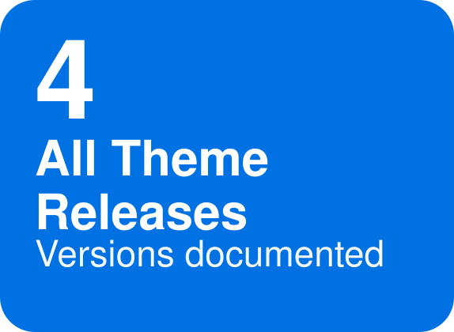
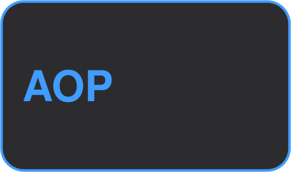
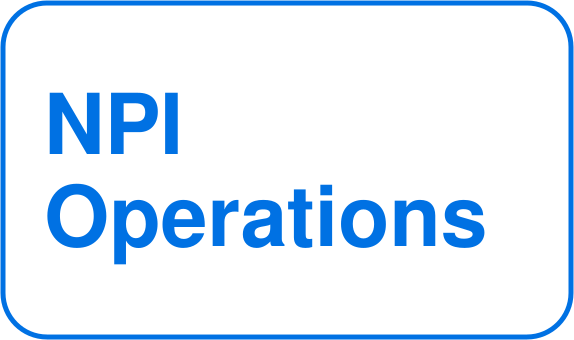
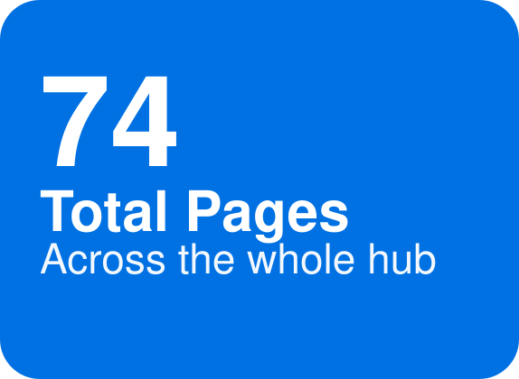
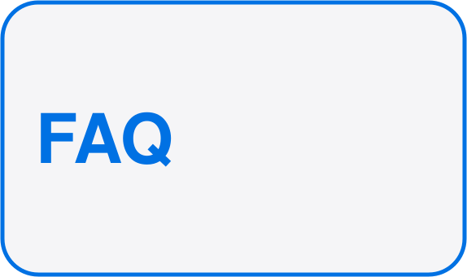

---
layout:
  width: wide
  title:
    visible: false
  description:
    visible: true
  tableOfContents:
    visible: true
  outline:
    visible: true
  pagination:
    visible: true
  metadata:
    visible: true
  tags:
    visible: true
  actions:
    visible: false
  anchors:
    visible: true
---

## Welcome to the APP Digital Program



<strong>1 new announcement</strong> — see <a href="theme-release/theme-release-2-8.md">2.8 Theme Release</a>



|  |  |  |  |  |
|--|--|--|--|--|
|  |  |  |  |  |

## Quick Start

<table data-view="cards"><thead><tr><th></th><th></th><th data-hidden data-card-target data-type="content-ref"></th><th data-hidden data-card-cover data-type="files"></th></tr></thead><tbody><tr><td><strong>🚀 Getting Started</strong></td><td>Onboarding, integration setup, access provisioning, and program terminology.</td><td><a href="getting-started/">getting-started</a></td><td></td></tr><tr><td><strong>🎨 CX Guidelines</strong></td><td>Design/UX standards, accessibility, localization, and customization patterns.</td><td><a href="cx-guidelines/">cx-guidelines</a></td><td></td></tr><tr><td><strong>📦 NPI Operations</strong></td><td>Readiness, delivery SLAs, milestones, and the missing-content runbook.</td><td><a href="npi-operations/">npi-operations</a></td><td></td></tr><tr><td><strong>📊 Analytics</strong></td><td>How to read performance/completeness reports and what's measured.</td><td><a href="analytics/">analytics</a></td><td></td></tr><tr><td><strong>🧩 Theme Release</strong></td><td>Release notes, migration guides, and deprecation notices.</td><td><a href="theme-release/">theme-release</a></td><td></td></tr><tr><td><strong>⚙️ Features &#x26; Functionality</strong></td><td>One landing page per capability area, each with its own Change Log.</td><td><a href="features-functionality/">features-functionality</a></td><td></td></tr><tr><td><strong>🛟 Support</strong></td><td>Partner UAT, product content support, and theme support.</td><td><a href="support/">support</a></td><td></td></tr><tr><td><strong>ℹ️ About Us</strong></td><td>The APP Digital program and its mission.</td><td><a href="about-us/">about-us</a></td><td></td></tr></tbody></table>

## Need Help?

<table data-view="cards"><thead><tr><th></th><th></th><th data-hidden data-card-target data-type="content-ref"></th><th data-hidden data-card-cover data-type="files"></th></tr></thead><tbody><tr><td><strong>🎫 File a support ticket</strong></td><td>Ticketing link coming soon.</td><td></td><td></td></tr><tr><td><strong>✏️ Request new content</strong></td><td>Request form coming soon.</td><td></td><td></td></tr></tbody></table>

Static section — only touch if the linked process or form changes.
