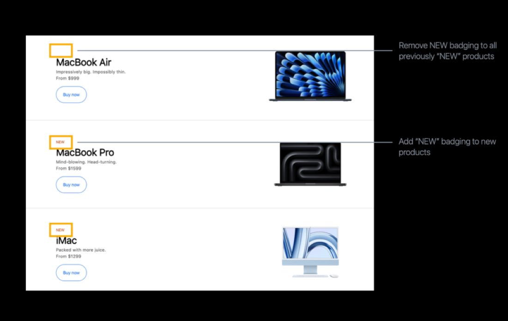
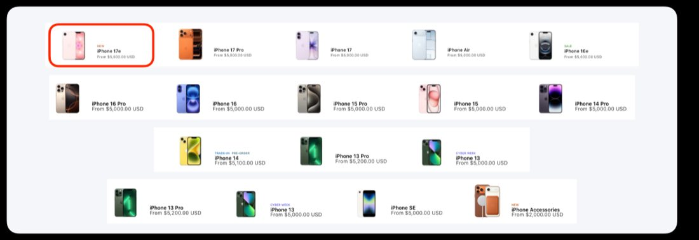
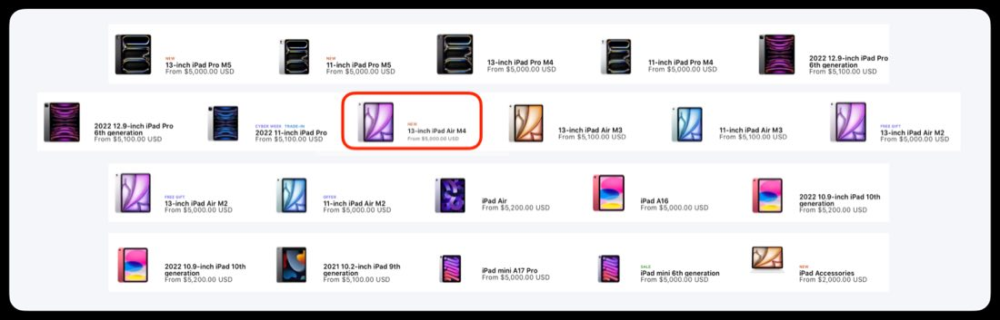
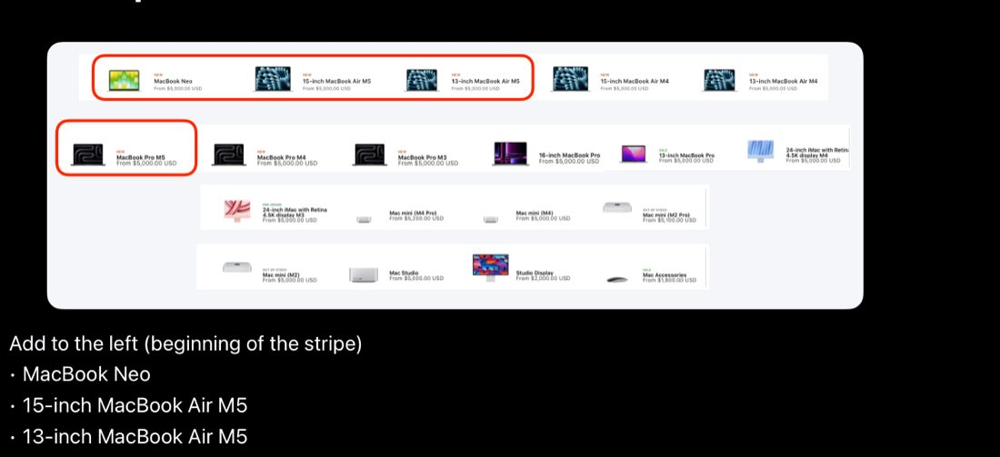
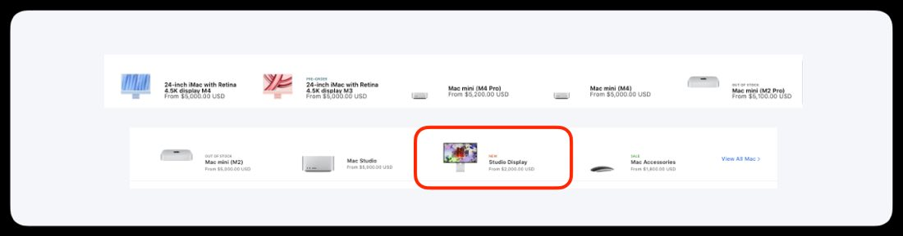
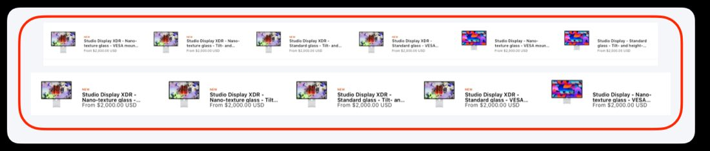

# Badging & stripes

The March 2026 NPI (New Product Introduction) CX guidance for badging and product stripes — the exact storefront changes for the March 2–4, 2026 Apple releases. Remove stale NEW badges and refresh every product stripe across the site with the new products.


**Compatible with APP theme 2.0 and newer** March 2026 NPI guidance.


## Badging and stripe updates

This is the March 2026 NPI (New Product Introduction) guidance. For the March 2–4, 2026 Apple releases, two things need to happen across the storefront: remove the **NEW** badges that have aged out, and update the product stripes so the new products appear in the right order. Work through the sections below in order — each one covers one badge task or one stripe.


**Where PLP badging lives**

This page covers NEW-badge removal and the marketing stripes. Badging shown on product-listing pages (PLPs) is handled separately — see [LOB & PLP pages](cx-lob-plp.md) for the line-of-business landing pages and product-listing page updates.


## NEW badging to remove

NEW badging should be removed **six months after a product announce**. The products below are no longer new, so their NEW badges should come off as part of this NPI:

- iPhone 17 Pro & Pro Max
- iPhone 17
- iPhone Air
- Apple Watch Series 11
- Apple Watch Ultra 3
- Apple Watch SE
- AirPods Pro 3

<figure><figcaption>Remove the NEW badge from each of these products — they have passed the six-month mark since announce.</figcaption></figure>

## iPhone stripe

Add **iPhone 17e** to the beginning (left) of the iPhone stripe.

<figure><figcaption>iPhone 17e leads the iPhone stripe.</figcaption></figure>

## iPad stripe

Add **2 new collections** to the beginning of the iPad Air section, in front of the 13-inch iPad Air M4:

1.  **13-inch iPad Air M4.** Add to the front of the iPad Air section.
2.  **11-inch iPad Air M4.** Add to the front of the iPad Air section, ahead of the existing 13-inch iPad Air M4.

<figure><figcaption>The two new iPad Air M4 collections lead the iPad Air section.</figcaption></figure>

## Accessories stripe

Update the **iPhone Accessories** tile to be the iPhone lockup from the Apple Store.

<figure><figcaption>The iPhone Accessories tile now uses the Apple Store iPhone lockup.</figcaption></figure>

## All Mac stripe

Update the All Mac stripe in two places:

1.  **Add to the left (beginning of the stripe):** MacBook Neo, 15-inch MacBook Air M5, 13-inch MacBook Air M5.
2.  **Between the MacBook Air M4 and the MacBook Pro M4:** add MacBook Pro M5 — move the existing MacBook Pro M5 to this collection.

<figure><figcaption>New Mac collections lead the stripe; MacBook Pro M5 sits between the MacBook Air M4 and the MacBook Pro M4.</figcaption></figure>

## Mac stripe

Update the **Studio Display** icon to the new Studio Display.

<figure><figcaption>The Studio Display icon now shows the new Studio Display.</figcaption></figure>

## Mac Studio Display stripe

Add the following icons to the left (beginning) of the stripe, in this order:

- Studio Display — Nano-texture glass — Tilt-adjustable stand
- Studio Display — Nano-texture glass — Tilt- and height-adjustable stand
- Studio Display — Nano-texture glass — VESA mount adapter
- Studio Display — Standard glass — Tilt-adjustable stand
- Studio Display — Standard glass — Tilt- and height-adjustable stand
- Studio Display — Standard glass — VESA mount adapter
- Studio Display XDR — Nano-texture glass — VESA mount adapter
- Studio Display XDR — Nano-texture glass — Tilt- and height-adjustable stand
- Studio Display XDR — Standard glass — Tilt- and height-adjustable stand
- Studio Display XDR — Standard glass — VESA mount adapter

<figure><figcaption>All ten Studio Display and Studio Display XDR configurations lead the stripe.</figcaption></figure>

## Feature timeline


**July 17, 2026** · `v1.0.0` · **ADDED** — Published the March 2026 NPI badging and stripe guidance: removing aged-out NEW badges (iPhone 17 Pro & Pro Max, iPhone 17, iPhone Air, Apple Watch Series 11, Ultra 3, SE, AirPods Pro 3) and updating the iPhone, iPad, Accessories, All Mac, Mac, and Studio Display stripes with the new products for the March 2–4, 2026 releases.

