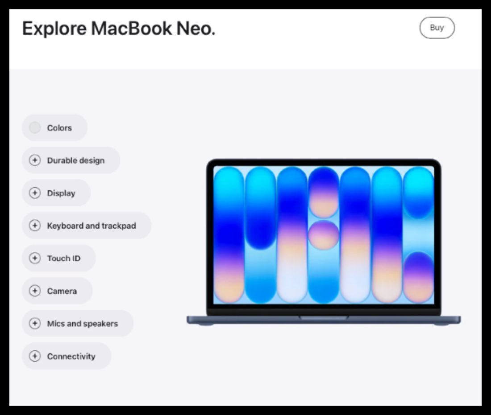

# Extras

Per the March 2026 NPI CX guidance, some partners received two optional modules for this launch: the MacBook Neo 2D viewer and animated video banners. These are only for partners who were given the assets — if you weren't, you can skip this page.


**Compatible with APP theme 2.0 and newer** March 2026 NPI guidance.


## Additional modules

Two optional modules were provided to some partners for this NPI: the [MacBook Neo 2D viewer](#macbook-neo-2d-viewer) and [animated video banners](#animated-video-banners). Only eligible partners received the assets for these modules.


**Optional and partner-specific**

These modules are not part of the standard PDP checklist. Implement them only if your Geo provided the corresponding asset.


## MacBook Neo 2D viewer

Marcom provided a new 2D-viewer asset for the MacBook Neo to some partners. Eligible partners can obtain this asset from their Partner Comms contact or Geo lead.

For implementation instructions, visit Bloomfire: <https://appdigital.bloomfire.com/posts/5952491-macbook-neo-2d-viewer-implementation>.

<figure><figcaption>The MacBook Neo 2D viewer.</figcaption></figure>

## Animated video banners

In some countries, Marcom provided a new animated video banner for the Homepage. To support this module on your Shopify site, modify the banner code as follows.

1.  **Add a video block to the settings.** In `slider_clickable.liquid`, add a video block at the very end of the file's settings:

        {
          "type": "video",
          "id": "video_file",
          "label": "Video"
        }

2.  **Render the video in the slide loop.** In the loop where you iterate through the carousel slides, add this block:

        
          {{ block.settings.video_file , muted: true, image_size: '2400w', preload: true}}


**Ask your theme developer**

These edits touch theme code. If you don't work in the theme's Liquid files directly, hand these two changes to your theme developer.


## Feature timeline


**July 17, 2026** · `v2.8` · **ADDED** — Documented the March 2026 NPI CX guidance for the two optional partner modules: the MacBook Neo 2D viewer (asset source and Bloomfire implementation link) and the animated homepage video banners (the two Liquid edits to slider_clickable.liquid).

