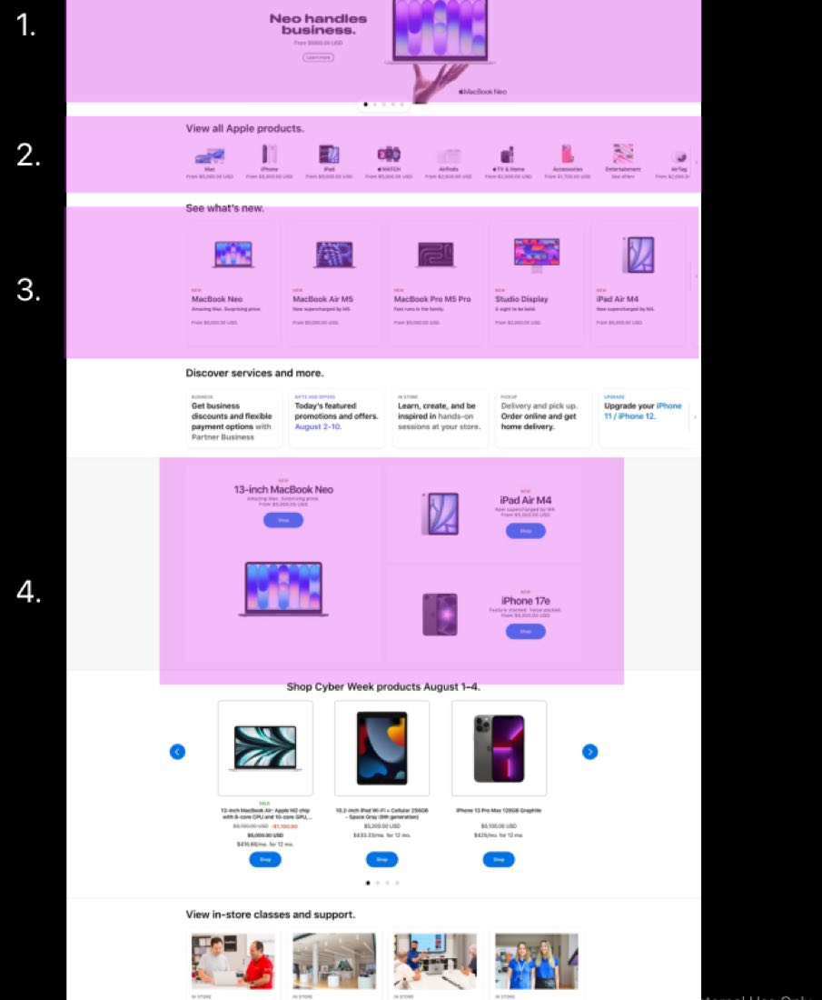
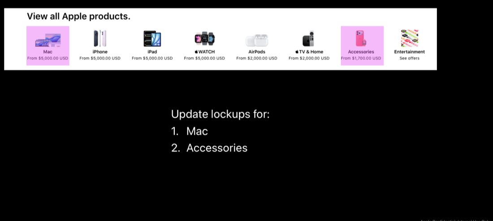
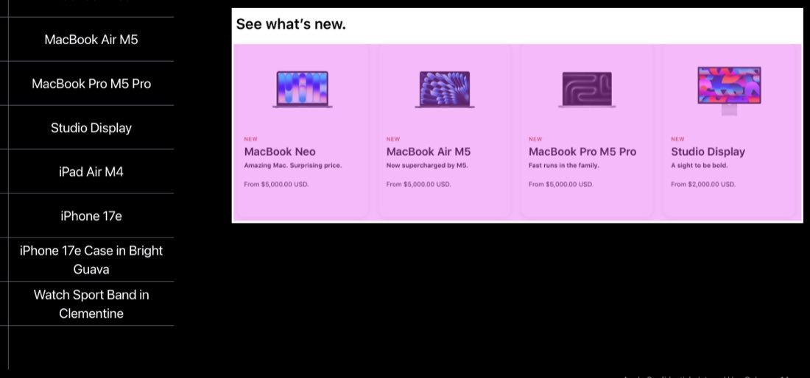
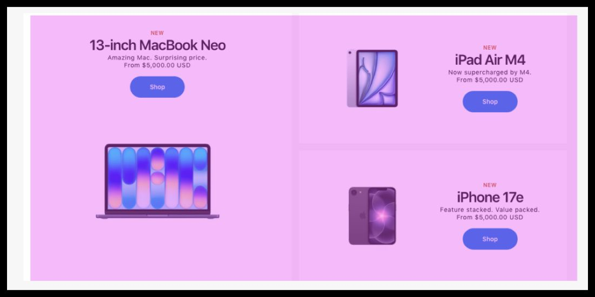
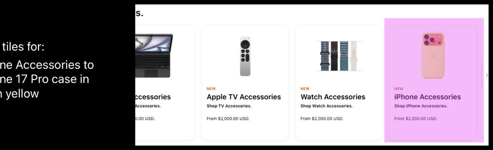
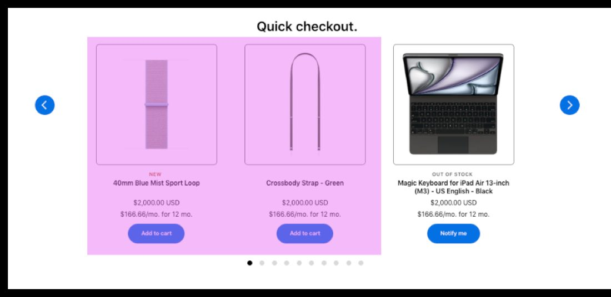

# Homepage updates

Part of the **March 2026 NPI CX guidance**. This page walks through the six homepage areas to update for the March 2–4, 2026 releases — the exact order and swaps for the carousel, stripes, What's New, bento box, featured accessories, and Quick Checkout.


**Compatible with APP theme 2.0 and newer** March 2026 NPI guidance.


## Homepage areas to update

For the March 2026 NPI there are **six areas** to update on the homepage. Work them top to bottom; each has its own section below with the exact order and swaps.

1.  **Homepage Carousel.** The rotating hero banners at the top of the page.
2.  **Homepage LOB Stripe.** The line-of-business lockups.
3.  **What's New.** The grid of new-product tiles.
4.  **Bento Box.** The mixed-size feature tiles.
5.  **Featured accessories.** The accessories tile row.
6.  **Quick Check Out.** The quick-add accessories rail.

<figure><figcaption>The homepage with areas 1–4 numbered: carousel, LOB stripe, What's New, and bento box.</figcaption></figure>

## Homepage carousel

Set the carousel slide order to the following, top to bottom:

| Order | Slide              |
|-------|--------------------|
| 1     | MacBook Neo        |
| 2     | iPhone 17e         |
| 3     | MacBook Pro M5 Pro |
| 4     | iPad Air M4        |
| 5     | Cyber Week         |

<figure><figcaption>Homepage carousel in the target order.</figcaption></figure>

## Homepage LOB stripe

Update the line-of-business lockups in the stripe to:

| Order | Lockup      |
|-------|-------------|
| 1     | Mac         |
| 2     | Accessories |

<figure><figcaption>Homepage LOB stripe — Mac and Accessories lockups.</figcaption></figure>

## What's New

Update the What's New tiles. The table maps each current placement to the suggested change:

| \#  | Current placement  | Suggested change                |
|-----|--------------------|---------------------------------|
| 1   | iPad Air M4        | MacBook Neo                     |
| 2   | iPhone 17e         | MacBook Air M5                  |
| 3   | iPad Pro M5        | MacBook Pro M5 Pro              |
| 4   | MacBook Pro M5     | Studio Display                  |
| 5   | iPhone 17 Pro      | iPad Air M4                     |
| 6   | Watch Ultra        | iPhone 17e                      |
| 7   | iPhone Accessories | iPhone 17e Case in Bright Guava |
| 8   | Watch Accessories  | Watch Sport Band in Clementine  |
| 9   | iPad Accessories   | Unchanged — none listed         |

<figure><figcaption>What's New tiles after the suggested changes.</figcaption></figure>

## Homepage bento box

Suggested changes for the bento box tiles:

| Tile | Suggested change |
|------|------------------|
| 1    | MacBook Neo      |
| 2    | iPad Air M4      |
| 3    | iPhone 17e       |

<figure><figcaption>Homepage bento box — MacBook Neo, iPad Air M4, and iPhone 17e.</figcaption></figure>

## Featured accessories

Update the featured accessories tiles:

| Current            | Suggested change                  |
|--------------------|-----------------------------------|
| iPhone Accessories | iPhone 17 Pro case in neon yellow |

<figure><figcaption>Featured accessories — iPhone 17 Pro case in neon yellow.</figcaption></figure>

## Quick checkout

Update the Quick Check Out accessories rail. Add the two new items at the top, then keep the existing items:

| \#  | Change   | Item                                      |
|-----|----------|-------------------------------------------|
| 1   | Add      | Apple Watch Sport Loop in Blue Mist       |
| 2   | Add      | Crossbody Strap in Green                  |
| 3   | Existing | Black Magic Keyboard for iPad Air 13-inch |
| 4   | Existing | Apple Pencil Pro                          |
| 5   | Existing | iPhone 17 Silicone Case                   |
| 6   | Existing | Apple Watch Trail Loop                    |
| 7   | Existing | iPhone Air MagSafe Battery                |
| 8   | Existing | Magic Trackpad 2                          |
| 9   | Existing | AirPods Pro 3                             |
| 10  | Existing | AirTag                                    |


**Screenshot to follow**

Screenshot to follow when Staging setup is complete.


<figure><figcaption>Quick Check Out rail with the two new accessories added at the top.</figcaption></figure>

## Feature timeline


**July 17, 2026** · `v2.8` · **ADDED** — Published the March 2026 NPI homepage-update guidance: the six homepage areas, the carousel slide order, the LOB stripe lockups, the What's New current-to-suggested tile map, the bento box swaps, the featured accessories change, and the Quick Check Out add/existing list.

