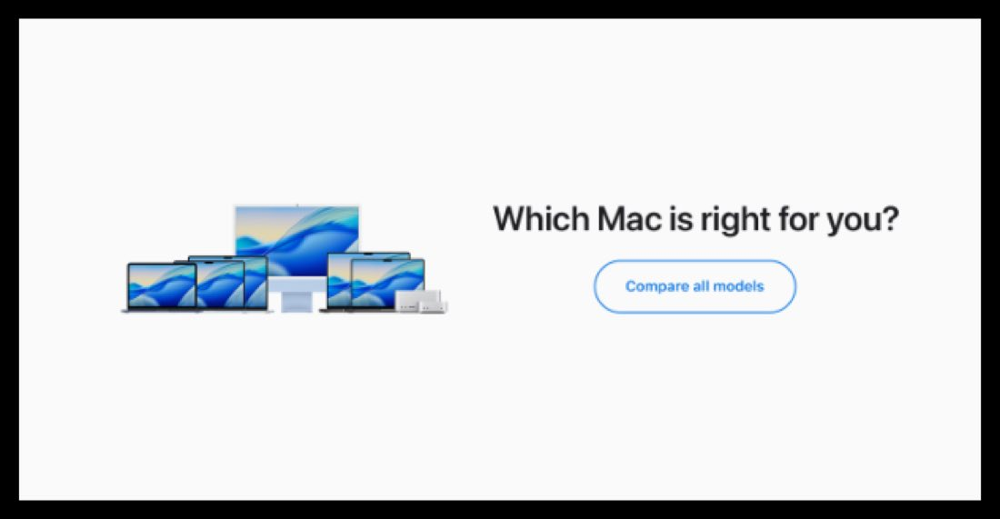
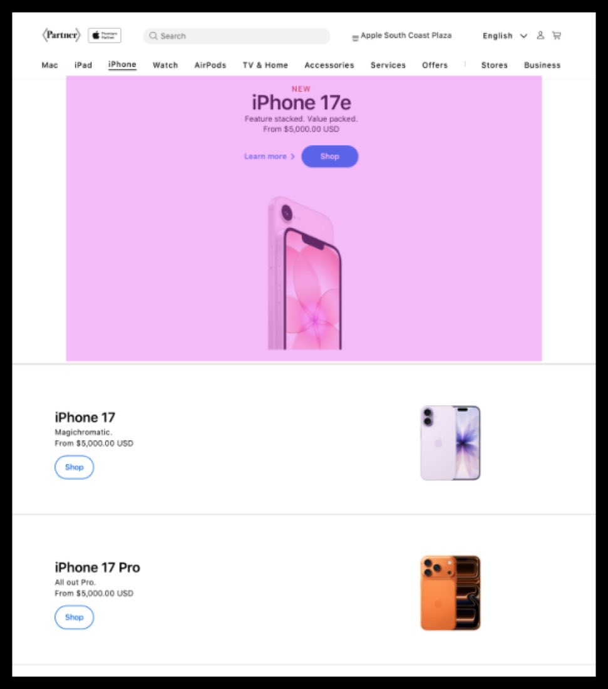
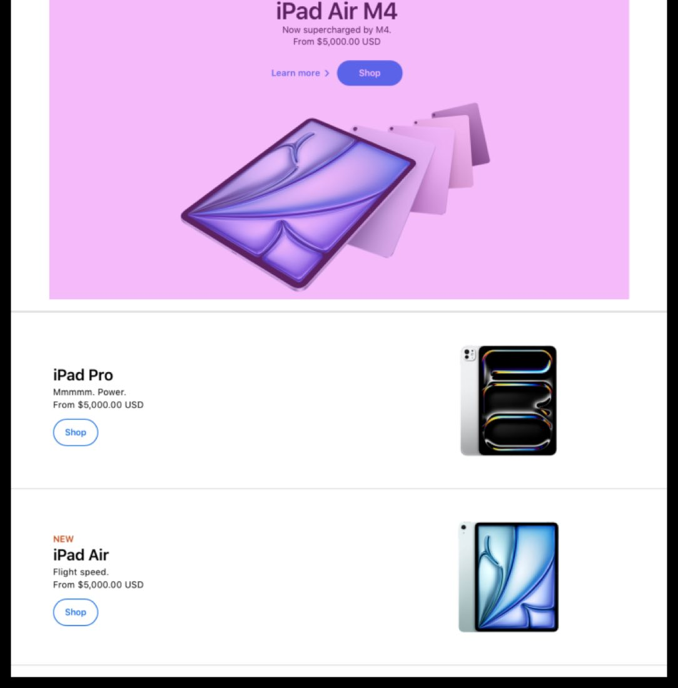
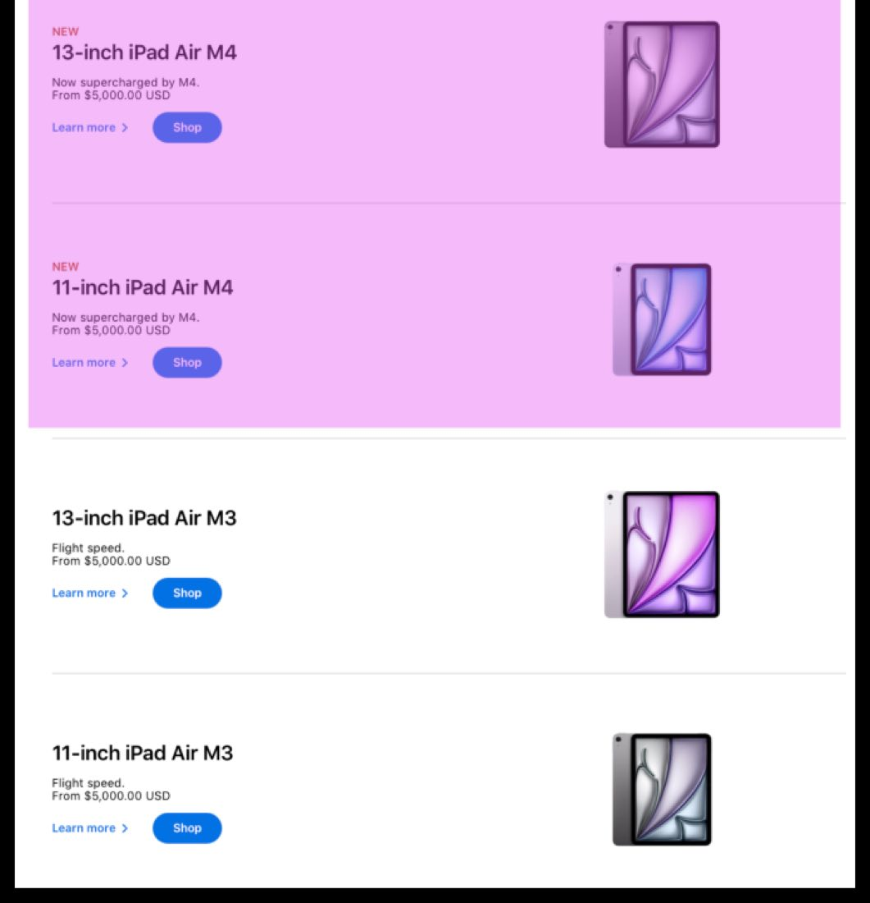
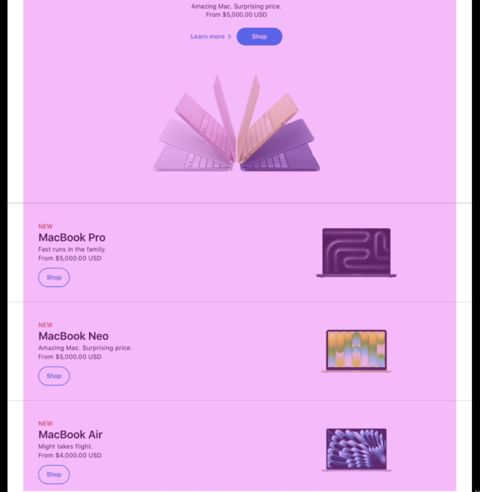
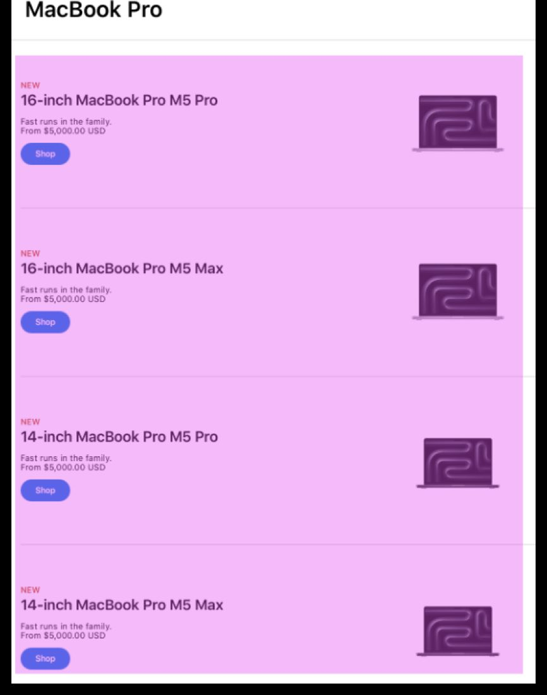
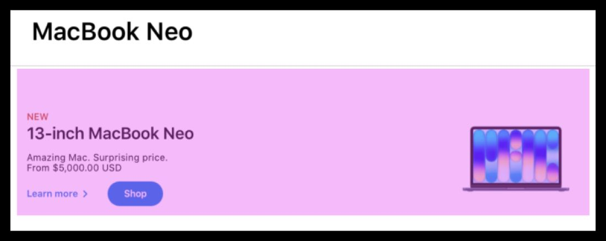

# LOB & PLP pages

The March 2026 NPI (New Product Introduction) CX guidance for the line-of-business landing pages and product-listing pages — the exact storefront changes for the March 2–4, 2026 Apple releases. Update the LOB landing pages and PLPs with the new banners, product ordering, and smart collections.


**Compatible with APP theme 2.0 and newer** March 2026 NPI guidance.


## LOB and PLP pages

This is the March 2026 NPI (New Product Introduction) guidance. LOB is the **Line Of Business** landing page; PLP is the **Product Listing Page**. For the March 2–4, 2026 releases, update the line-of-business landing pages and product-listing pages with the new banners, product ordering, and smart collections described below.


**Related badging & stripes**

NEW-badge removal and the marketing product stripes are covered separately — see [Badging & stripes](cx-badging-stripes.md).


## Product family images & search banners

Before updating the individual pages, pull the shared assets and follow the CX guidance document that ships with them.

1.  **Download the Photoshop assets from the Box folder.** [apple.box.com/s/eaqwpxvetlbk2hwadt7z61d7akyrxbev](https://apple.box.com/s/eaqwpxvetlbk2hwadt7z61d7akyrxbev) — password `APP123@@`. The folder includes PSD templates for both Desktop and Mobile banners.
2.  **Review the CX guidance document** in the same folder, beginning on **Slide 17**.
3.  **Follow the steps provided** in that guidance to produce the family images and search banners.


**Link expires over time**

The Box link expires over time. If it's inactive, file an APP support ticket to get a current link.


<figure><figcaption>Family images and search banners produced from the Desktop and Mobile PSD templates.</figcaption></figure>

## iPhone LOB page

Use the **iPhone 17e banner**. Reorder the list as follows, then continue with older models:

1.  **iPhone 17**
2.  **iPhone 17 Pro**
3.  **iPhone 17e**

<figure><figcaption>iPhone LOB with the iPhone 17e banner and the new order: iPhone 17, iPhone 17 Pro, iPhone 17e, then older models.</figcaption></figure>

## iPad LOB page

Use the **iPad Air M4 banner**. Reorder the list as follows, then continue with older models:

1.  **iPad Pro**
2.  **iPad Air**
3.  **iPad**

<figure><figcaption>iPad LOB with the iPad Air M4 banner and the new order: iPad Pro, iPad Air, iPad, then older models.</figcaption></figure>

## iPad Air PLP page

Add **2 smart collections** to the top of the iPad Air PLP:

- 13-inch iPad Air M4
- 11-inch iPad Air M4

<figure><figcaption>The two new iPad Air M4 smart collections lead the iPad Air PLP.</figcaption></figure>

## Mac LOB page

Update the banner to **MacBook Neo**. Update the order to:

1.  **MacBook Pro**
2.  **MacBook Neo**
3.  **MacBook Air**

<figure><figcaption>Mac LOB with the MacBook Neo banner and the new order: MacBook Pro, MacBook Neo, MacBook Air.</figcaption></figure>

## MacBook Pro PLP

Add the following smart collections to the top of the MacBook Pro PLP:

- 16-inch MacBook Pro M5 Pro
- 16-inch MacBook Pro M5 Max
- 14-inch MacBook Pro M5 Pro
- 14-inch MacBook Pro M5 Max
- 14-inch MacBook Pro

<figure><figcaption>The new MacBook Pro M5 smart collections lead the MacBook Pro PLP.</figcaption></figure>

## MacBook Neo PLP

Create a **new PLP** with the MacBook Neo smart collection.

<figure><figcaption>The new MacBook Neo PLP, built from the MacBook Neo smart collection.</figcaption></figure>

## Feature timeline


**July 17, 2026** · `v2.8` · **ADDED** — Published the March 2026 NPI LOB and PLP guidance: sourcing family images and search banners from the Box PSD templates, the iPhone and iPad LOB banner and reorder changes, the Mac LOB MacBook Neo banner and reorder, the new iPad Air and MacBook Pro smart collections, and the new MacBook Neo PLP for the March 2–4, 2026 releases.

