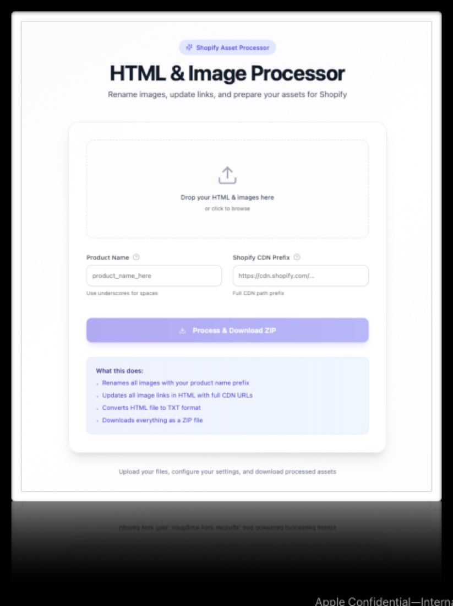
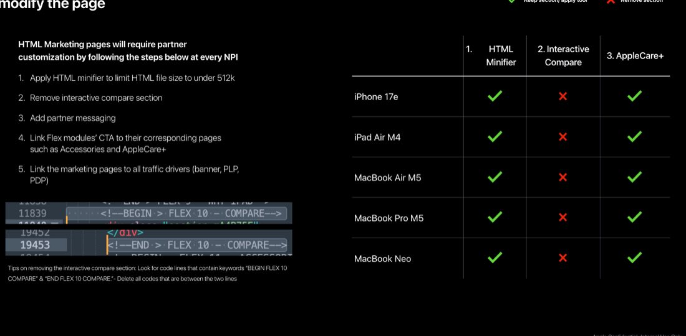
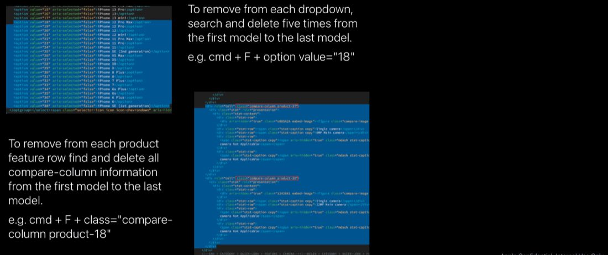

# Marketing & compare pages

Part of the March 2026 NPI (new-product introduction) CX guidance. How you set up marketing pages and compare pages depends on whether your store has the theme patch. This page covers the new patch-based upload process and the manual steps for partners who don't yet have the patch.


**Compatible with APP theme 2.0 and newer** March 2026 NPI guidance.


## Marketing and compare pages

Whether you follow the new or old process depends on your theme patch. Partners who have implemented theme patch **2.4.4** or **1.2.1** can use the new marketing-page process outlined in the patch documentation. Partners who have **not** implemented the patch are encouraged to implement it before the next NPI for the best experience; for now, follow the manual steps below.


**Reminders from prior NPIs**

The manual steps that follow are reminders from prior NPIs that remain useful. If you have the patch, skip ahead to [New upload process](#new-marketing-page-upload-process-with-patch).


## New marketing page upload process (with patch)

If you have implemented patch **2.4.4** or **1.2.1**, follow the setup instructions on Bloomfire. The patch-based process has several benefits over the manual HTML process:

- Bypasses Shopify size limitations.
- Lets you implement all marketing-page modules.
- Improved user experience with less manual work.

Instructions: [Instructions for marketing content pages using the Shopify CDN](https://appdigital.bloomfire.com/groups/58425/posts/5920008-instructions-for-marketing-content-pages-using-the-shopify-cdn).

<figure><figcaption>The new marketing-page upload process, available with patch 2.4.4 or 1.2.1.</figcaption></figure>

## HTML marketing pages (no patch)

Partners without the patch must customize HTML marketing pages at every NPI. Work through these steps:

1.  **Minify the HTML.** Apply an HTML minifier to keep the HTML file under 512 KB.
2.  **Remove the interactive compare section.** Delete the interactive compare section from the page.
3.  **Add partner messaging.** Add your partner messaging to the page.
4.  **Link the Flex modules' CTAs.** Link the Flex modules' CTAs to their corresponding pages, such as Accessories and AppleCare+.
5.  **Link the marketing pages to all traffic drivers.** Link the marketing pages to every traffic driver — banner, PLP, and PDP.


**Removing the interactive compare section**

To remove the interactive compare section, look for the code lines containing the keywords `BEGIN FLEX 10 COMPARE` and `END FLEX 10 COMPARE`, and delete all code between those two lines.


<figure><figcaption>Customizing an HTML marketing page for partners without the patch.</figcaption></figure>

## Compare pages (no patch)

Compare pages can be modified to meet Shopify's size restriction — keep the file under 512 KB. Partners should remove any iPhone models they don't carry from the compare module. Instructions are in the Relay download: **Compare Page HTML > Read Me** folder, under **"Product Removal."**

You must remove the unwanted model(s) from each individual product dropdown **and** the individual rows within the compare table:

1.  **Remove from each product dropdown.** Search and delete five times, from the first model to the last model. For example, press `cmd + F`, then search for `option value="18"` and delete each match.
2.  **Remove from each product-feature row.** Find and delete all compare-column info from the first model to the last. For example, press `cmd + F`, then search for `class="compare-column product-18"` and delete each match.

<figure><figcaption>Removing an unwanted iPhone model from a compare page's dropdowns and table rows.</figcaption></figure>

## Feature timeline


**July 17, 2026** · `v2.8` · **ADDED** — Documented the March 2026 NPI marketing & compare page guidance for the APP theme: the new patch-based marketing upload process (patch 2.4.4 / 1.2.1) using the Shopify CDN, the manual HTML marketing-page steps for partners without the patch (minify, remove the interactive compare section, add partner messaging, link Flex CTAs and traffic drivers), and how to trim compare pages under Shopify's size limit by removing unwanted iPhone models from each dropdown and compare-table row.

