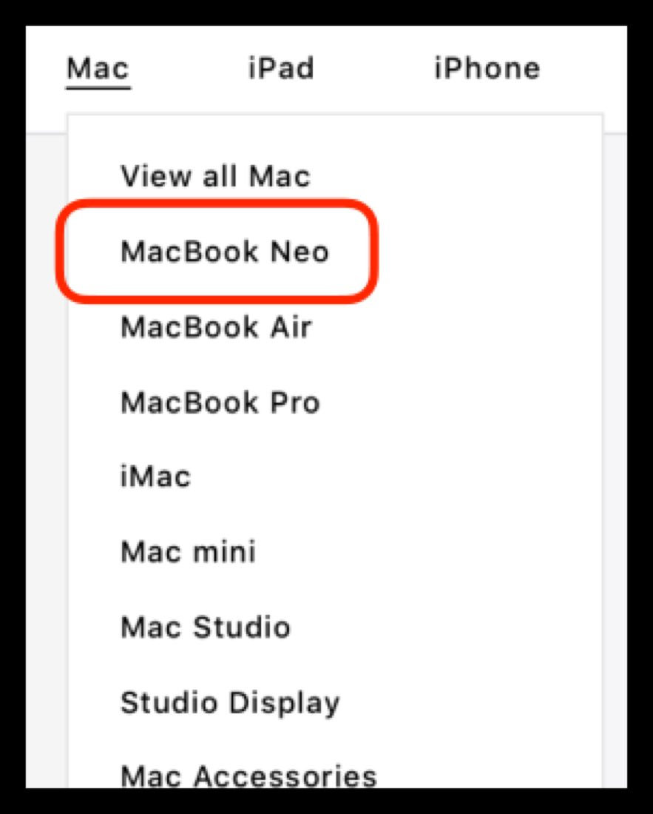

# Navigation

Part of the March 2026 NPI (new-product introduction) CX guidance. When new products launch, the storefront's main navigation menus need to be updated so shoppers can find them. This page covers the menu changes for the Mac line.


**Compatible with APP theme 2.0 and newer** March 2026 NPI guidance.


## Navigation changes

For this NPI, the main navigation menus need the new products added so that shoppers can reach the newly launched pages from the storefront's primary menus. Work through the menu update below, then confirm the new entries appear in both the desktop dropdown and the mobile menu drawer.

## Mac navigation

Add **MacBook Neo** to the top of the Mac navigation menu so it is the first item shoppers see when they open the Mac menu.

<figure><figcaption>The Mac navigation menu with MacBook Neo placed at the top.</figcaption></figure>

## Feature timeline


**July 17, 2026** · `v1.0.0` · **ADDED** — Documented the March 2026 NPI navigation guidance for the APP theme: adding newly launched products to the main navigation menus, including placing MacBook Neo at the top of the Mac navigation menu.

