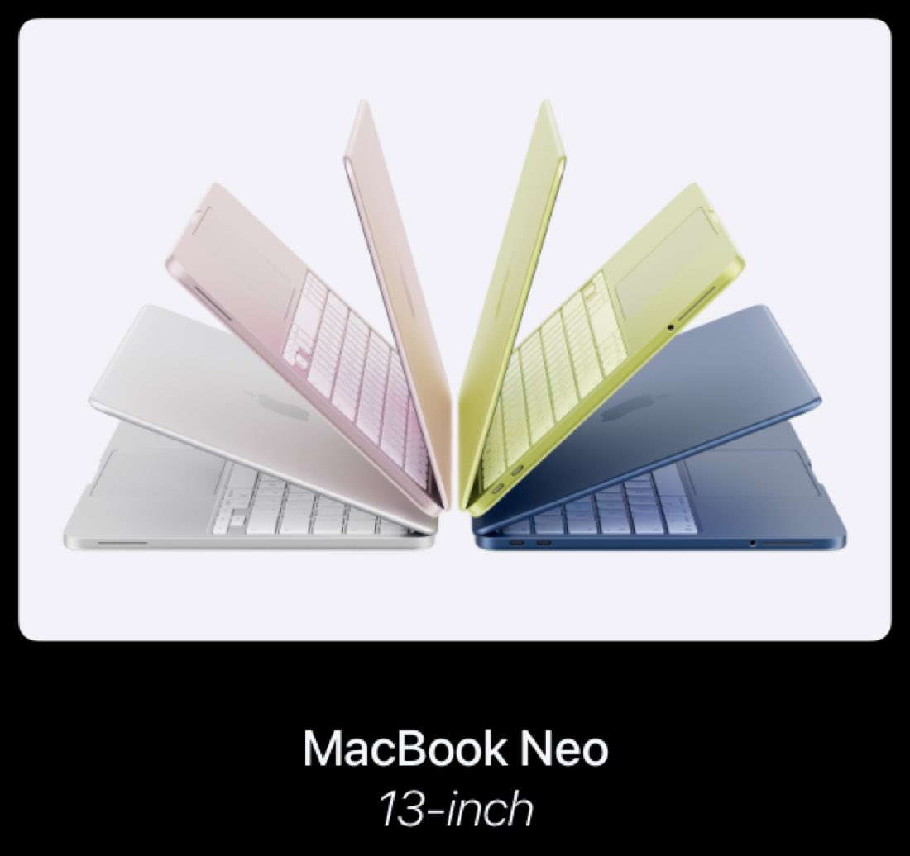
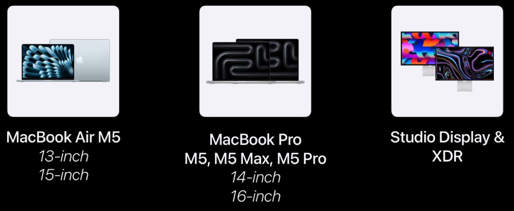
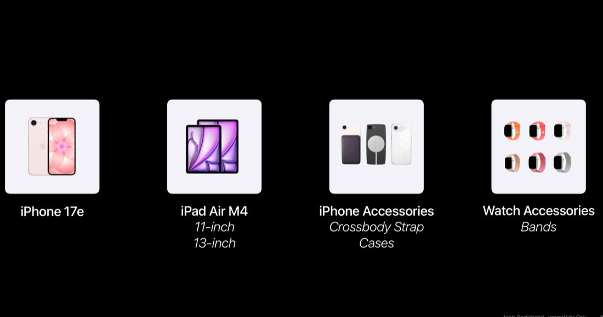

# Overview & release scope

This is the **March 2026 NPI CX guidance** — the partner checklist and step-by-step for updating your storefront for the March 2–4, 2026 Apple product releases. Start here to see everything that's launching, then work through the linked pages for each area of the store.


**Compatible with APP theme 2.0 and newer** March 2026 NPI guidance.


## About this guidance

This is the **March 2026 NPI CX guidance** (NPI = New Product Introduction). It's the partner checklist and step-by-step for updating your Apple-branded storefront for the **March 2–4, 2026** product releases — what to add, what to re-order, and where the new badging and imagery go.

Work this page first to understand the full release scope, then use the area-specific pages for the detailed changes:

| Page | What it covers |
|----|----|
| [Homepage updates](cx-homepage.md) | Carousel, LOB stripe, What's New, Bento box, Featured accessories, Quick Checkout. |
| [Badging & stripes](cx-badging-stripes.md) | Product badges and the LOB / homepage stripes. |
| [LOB & PLP pages](cx-lob-plp.md) | Line-of-business and product-listing pages — new products and badging. |
| [Navigation](cx-navigation.md) | Menu and navigation updates for the new products. |
| [Marketing & compare](cx-marketing-compare.md) | HTML marketing pages and compare pages. |
| [PDP updates](cx-pdp.md) | Product detail pages — activation, Notify Me, What's in the Box. |
| [Extras](cx-extras.md) | Frequently Bought Together, tooltips, and other finishing touches. |

## The NPI partner checklist

Thirteen items to work through for this release. Do them roughly in order — product setup and pricing come first, then the storefront CX, then the PDP and finishing touches. Each item links to its detailed guidance where one exists.

1.  **Product Setup.** Access marketing content from Box/Relay and wait for the automated content delivery to complete for the new products.
2.  **Add Pricing, Inventory + Notify Me options.** Set pricing and inventory, and enable Notify Me where a product isn't yet purchasable.
3.  **Update Homepage CX — update Homepage Carousel.** Re-order the carousel for the new launches. See [Homepage updates](cx-homepage.md).
4.  **Update What's New.** Refresh the What's New tiles. See [Homepage updates](cx-homepage.md).
5.  **Update Bento Box.** Swap the bento tiles for the new hero products. See [Homepage updates](cx-homepage.md).
6.  **Update Quick Checkout.** Add and re-order the Quick Checkout accessories. See [Homepage updates](cx-homepage.md).
7.  **Update Stripes.** Update the stripes as indicated in the deck. See [Badging & stripes](cx-badging-stripes.md).
8.  **Update LOB and PLP pages.** Add the new products and their badging to the line-of-business and product-listing pages. See [LOB & PLP pages](cx-lob-plp.md).
9.  **HTML and Compare pages.** Review the guidance and setup for any new pages. See [Marketing & compare](cx-marketing-compare.md).
10. **Update PDP page.** Set the product to active and enable the Notify Me CTA. See [PDP updates](cx-pdp.md).
11. **Check What's in the Box image against your inventory.** Confirm the packaged contents shown match what you actually ship. See [PDP updates](cx-pdp.md).
12. **Add Frequently Bought Together.** Set up FBT for the new products. See [Extras](cx-extras.md).
13. **Add tooltips.** Add the tooltips called out for this release. See [Extras](cx-extras.md).

## Staging site & guidance notes

A demo staging site is available for partner reference while you work through this release. Use it to see the intended end state of each CX area.

| Staging site | Value                     |
|--------------|---------------------------|
| URL          | <https://appstaging.dev/> |
| Password     | `APP123@@`                |


**Prices on staging are not real**

The staging site is a demo for partner reference only — the prices shown are **not real** and are for demonstration only.



**Staging is on the Store 2.0 theme**

Staging has been updated to the **Store 2.0** theme. If you haven't upgraded yet, APPs will notice differences between staging and their own storefront.



**Defer to local Marcom / PCM guidance**

If your local Marcom or PCM teams give you conflicting guidance, **defer to theirs**. This document is the broad case; your local team tailors the release to your consumers and available assets.


## Tiles, swatches & CX mapping

Tile and swatch storage becomes available on Box once the staging setup is complete. Use it to pull the imagery you need for the homepage, PLP, and PDP updates.

| Resource | Value |
|----|----|
| Box (tiles & swatches) | <https://apple.box.com/s/ej36uphozmnupn1diku65kju62twfvv4> |
| Box password | `APP123@@` |


**The Box link expires**

The Box link expires over time. If it's inactive when you try it, file an **APP support ticket** to get a fresh link.


### CX Partners: product-option mapping

CX Solution partners can reference the **CX Solution - Apple Products Option Mapping File** on Bloomfire for product-mapping updates: <https://appdigital.bloomfire.com/groups/58425/series/5486429-cx-solution-product-data>

## What's releasing

The March 2026 NPI lands in three waves across March 2–4. The products in each wave are shown below.

### March 4

| Product             |
|---------------------|
| MacBook Neo 13-inch |

<figure><figcaption>March 4 release — MacBook Neo 13-inch.</figcaption></figure>

### March 3

| Product                                             |
|-----------------------------------------------------|
| Studio Display & XDR                                |
| MacBook Air M5 (13-inch, 15-inch)                   |
| MacBook Pro M5 / M5 Max / M5 Pro (14-inch, 16-inch) |

<figure><figcaption>March 3 release — Studio Display &amp; XDR, MacBook Air M5, and the MacBook Pro M5 lineup.</figcaption></figure>

### March 2

| Product                                     |
|---------------------------------------------|
| iPhone 17e                                  |
| iPad Air M4 (11-inch, 13-inch)              |
| iPhone Accessories (Crossbody Strap, Cases) |
| Watch Accessories (Bands)                   |

<figure><figcaption>March 2 release — iPhone 17e, iPad Air M4, and iPhone / Watch accessories.</figcaption></figure>

## Mac duplicate MPNs

As you set up the new Macs, you may see **two or more MPNs of the same product**. This is expected — it indicates that multiple keyboard languages are available in your country, each with its own MPN.


**Reference documentation**

Bloomfire documentation helps explain the duplicate-MPN behavior: <https://appdigital.bloomfire.com/questions/5499035>


## Feature timeline


**July 17, 2026** · `v1.0.0` · **ADDED** — Published the March 2026 NPI CX guidance overview: the 13-item partner checklist, the staging site and guidance notes (defer to local Marcom/PCM), where to get tiles/swatches and the CX option-mapping file, the full March 2–4 release scope across three waves, and the note on duplicate Mac MPNs for multi-keyboard-language countries.

