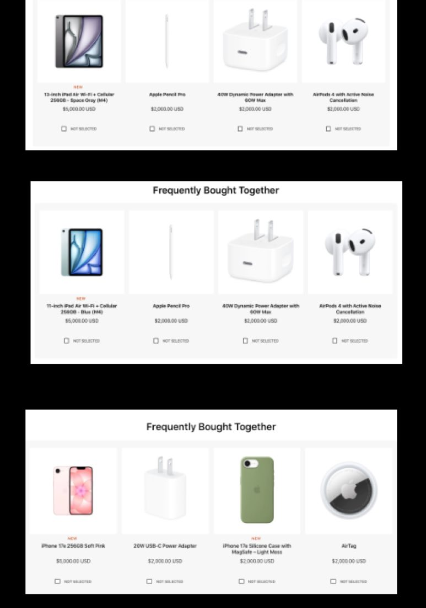
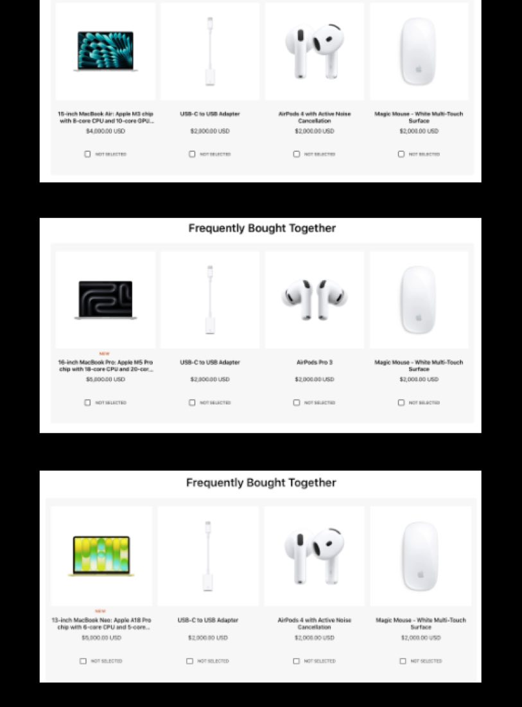
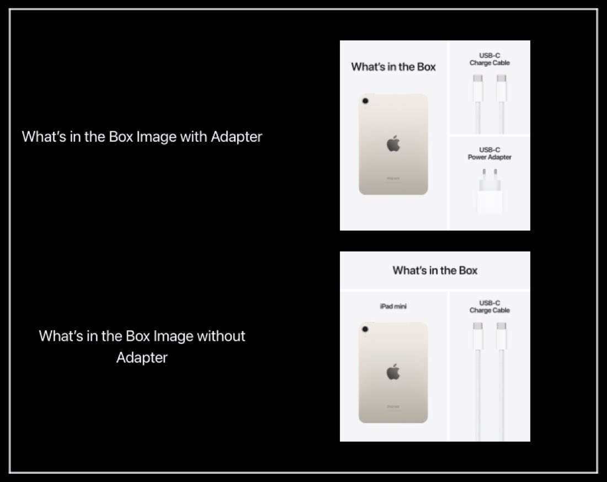

# PDP updates

Per the March 2026 NPI CX guidance, this is the product detail page (PDP) checklist to run for each new product in this launch: set the product active, enable the Notify Me CTA, add Frequently Bought Together, verify the What's in the Box image, and add tooltips. Work these in order for every PDP before you publish.


**Compatible with APP theme 2.0 and newer** March 2026 NPI guidance.


## PDP updates

For each new product's PDP in this NPI, set the product to **active** and enable the **Notify Me** CTA so shoppers can register interest before stock lands. Once the product is live, complete the rest of the PDP checklist: add [Frequently Bought Together](#frequently-bought-together), verify the [What's in the Box](#whats-in-the-box-images) image, and add [tooltips](#tooltips).


**Run these in order**

Activate the product and enable Notify Me first, then FBT, then confirm the What's in the Box image, and finish with tooltips. Tooltips are the final checklist item before you publish the PDP.


## Frequently bought together

Set the Frequently Bought Together (FBT) recommendations per product using the assignments below. Match each product's PDP to its listed accessories.

| Product | FBT recommendations |
|----|----|
| 13-inch iPad Air M4 | Apple Pencil Pro; Magic Keyboard for iPad Air 13-inch; 40W Dynamic Power Adapter with 60W Max; AirPods 4 with Active Noise Cancellation. |
| 11-inch iPad Air M4 | Apple Pencil Pro; Magic Keyboard for iPad Air 11-inch; 40W Dynamic Power Adapter with 60W Max; AirPods 4 with Active Noise Cancellation. |
| iPhone 17e | 20W USB-C Power Adapter; iPhone 17e Silicone Case in Light Moss; AirTag; AirPods 4. |
| MacBook Air M5 | USB-C to USB Adapter; AirPods 4 with Active Noise Cancellation; Magic Mouse (USB-C); USB-C Charge Cable (2m). |
| MacBook Pro M5, M5 Max, and M5 Pro | USB-C to USB Adapter; AirPods Pro 3; Magic Mouse (USB-C); USB-C Charge Cable (2m). |
| MacBook Neo | USB-C to USB Adapter; AirPods 4 with Active Noise Cancellation; Magic Mouse (USB-C); USB-C Charge Cable (2m). |

<figure><figcaption>FBT modules on the iPad Air and iPhone 17e PDPs.</figcaption></figure>

<figure><figcaption>FBT modules on the MacBook Air, MacBook Pro, and MacBook Neo PDPs.</figcaption></figure>

## What's in the box images

Partners should review the What's In the Box image provided by CaaS and confirm it's the right one for their country by comparing it to the Marcom images in Relay or Box. Swap the image as necessary.


**WW-EN may have two versions**

For WW-EN, Marcom may provide two versions of the image — one with the plug and one without. CaaS provides only one image in the product gallery, so confirm you have the correct version for your market.



**Watch for an extra image**

Because the number of images in the PDP gallery varies, some partners may receive an **extra** What's in the Box image. That extra image should be removed before publishing.


<figure><figcaption>The What's in the Box image as it appears in the PDP gallery.</figcaption></figure>

## Tooltips

Adding tooltips to the PDP is the final checklist item. Add tooltips per the example shown below.

<figure><figcaption>Tooltips example — add tooltips to the PDP to match this pattern.</figcaption></figure>

## Feature timeline


**July 17, 2026** · `v1.0.0` · **ADDED** — Documented the March 2026 NPI CX guidance for PDP updates: activating each product and enabling the Notify Me CTA, setting Frequently Bought Together recommendations per product (iPad Air, iPhone 17e, and the MacBook line), verifying and swapping the What's in the Box image (including the WW-EN plug/no-plug versions and removing any extra image), and adding tooltips.

