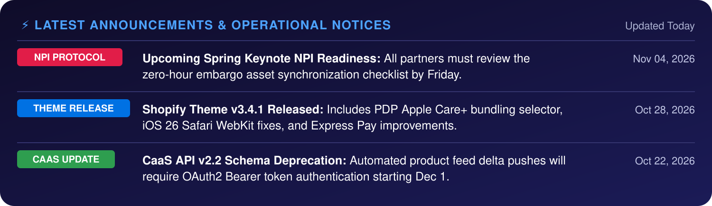

---
layout:
  width: wide
  title:
    visible: false
---

<figure><picture><source srcset=".gitbook/assets/hub-headline-dark.svg" media="(prefers-color-scheme: dark)"></picture><figcaption></figcaption></figure>

Official technical documentation, theme code releases, NPI launch protocols, CaaS integration specs and CX design systems for global Apple Premium Partner e-commerce operations.

🟢 **Shopify Theme: v3.4.1 (Stable)** &nbsp;&nbsp; 🟣 **CX-S Figma Token Kit: v2026.3**

<figure><picture><source srcset=".gitbook/assets/announcements-dark.svg" media="(prefers-color-scheme: dark)"></picture><figcaption></figcaption></figure>

## What's New Since Your Version

Select your platform, then find your baseline to see the key highlights and upgrades since your deployment.




**Your store is on v3.0.x (deployed about 6 months ago)**

<table data-view="cards"><thead><tr><th></th><th></th><th data-hidden data-card-target data-type="content-ref"></th><th data-hidden data-card-cover data-type="files"></th></tr></thead><tbody><tr><td><strong>v3.4.0 · E-Com Conversion — AppleCare+ PDP Auto-Bundling Drawer</strong></td><td>Attach 2-year AppleCare+ coverage from the PDP capacity selector.</td><td><a href="features/pdp-device-config/applecare-auto-bundling.md">features/pdp-device-config/applecare-auto-bundling.md</a></td><td></td></tr><tr><td><strong>v3.2.0 · Checkout — Apple Pay One-Touch Express Checkout</strong></td><td>Native Apple Pay sheet that skips the cart page on compatible Safari devices.</td><td><a href="features/checkout-express-pay/apple-pay-one-touch.md">features/checkout-express-pay/apple-pay-one-touch.md</a></td><td></td></tr><tr><td><strong>v3.4.1 · Mobile UX — Trade-In Valuation Widget Integration</strong></td><td>Interactive trade-in credit estimator on iPhone/Mac PDPs.</td><td><a href="features/pdp-device-config/trade-in-valuation-widget.md">features/pdp-device-config/trade-in-valuation-widget.md</a></td><td></td></tr></tbody></table>

**Your store is on v3.2.x (deployed about 3 months ago)**

<table data-view="cards"><thead><tr><th></th><th></th><th data-hidden data-card-target data-type="content-ref"></th><th data-hidden data-card-cover data-type="files"></th></tr></thead><tbody><tr><td><strong>v3.4.0 · New in v3.4 — AppleCare+ PDP Auto-Bundling Drawer</strong></td><td>Automated warranty upsell drawer with dynamic SKU pricing from the CaaS feed.</td><td><a href="features/pdp-device-config/applecare-auto-bundling.md">features/pdp-device-config/applecare-auto-bundling.md</a></td><td></td></tr><tr><td><strong>v3.4.1 · Mobile UX — Trade-In Valuation Widget Integration</strong></td><td>Trade-in estimate on the PDP without leaving the buy flow.</td><td><a href="features/pdp-device-config/trade-in-valuation-widget.md">features/pdp-device-config/trade-in-valuation-widget.md</a></td><td></td></tr><tr><td><strong>v3.4.1 · Hotfix — iOS 26 Safari Sticky Header WebKit Patch</strong></td><td>Removes jumpy header scroll jitter on mobile viewports.</td><td><a href="theme-releases/changelog-by-version.md">theme-releases/changelog-by-version.md</a></td><td></td></tr></tbody></table>

**Your store is on v2.8.x (legacy 2025)**

<table data-view="cards"><thead><tr><th></th><th></th><th data-hidden data-card-target data-type="content-ref"></th><th data-hidden data-card-cover data-type="files"></th></tr></thead><tbody><tr><td><strong>Major architecture · v3.0+ — Shopify Online Store 2.0 JSON Template Migration</strong></td><td>No-code modular blocks for your marketing team, with full CaaS delta feed compatibility.</td><td><a href="theme-releases/release-schedule-and-sla.md">theme-releases/release-schedule-and-sla.md</a></td><td></td></tr><tr><td><strong>Checkout · v3.2+ — Apple Pay One-Touch Express Checkout</strong></td><td>Direct Apple Pay sheet bypass reduces mobile drop-off.</td><td><a href="features/checkout-express-pay/apple-pay-one-touch.md">features/checkout-express-pay/apple-pay-one-touch.md</a></td><td></td></tr><tr><td><strong>Merchandising · v3.4+ — AppleCare+ Bundling &amp; Trade-In Suite</strong></td><td>Complete Apple Premium Partner conversion suite built into Liquid templates.</td><td><a href="features/pdp-device-config/applecare-auto-bundling.md">features/pdp-device-config/applecare-auto-bundling.md</a></td><td></td></tr></tbody></table>




**Your last CX design sync was the 2025 Q4 Design Kit (v2025.4)**

<table data-view="cards"><thead><tr><th></th><th></th><th data-hidden data-card-target data-type="content-ref"></th><th data-hidden data-card-cover data-type="files"></th></tr></thead><tbody><tr><td><strong>New component · CX-S v2026.3 — PDP AppleCare+ Bottom Sheet Modal</strong></td><td>Figma spec for AppleCare+ terms, breakdown and legal disclosures on custom engines.</td><td><a href="features/pdp-device-config/applecare-auto-bundling.md">features/pdp-device-config/applecare-auto-bundling.md</a></td><td></td></tr><tr><td><strong>Design tokens · v2026.2 — SF Pro Typography &amp; Spacing Scale v2</strong></td><td>Updated font licensing specs, line-heights and 8pt responsive grid tokens.</td><td><a href="cx-guidelines/figma-design-tokens.md">cx-guidelines/figma-design-tokens.md</a></td><td></td></tr><tr><td><strong>UX pattern · v2026.3 — Interactive Device Color Swatch Switcher</strong></td><td>Figma prototype for metallic finish swatches and 360-degree viewports.</td><td><a href="cx-guidelines/brand-merchandising-rules.md">cx-guidelines/brand-merchandising-rules.md</a></td><td></td></tr></tbody></table>

**Your last CX design sync was the 2026 Q1 Design Kit (v2026.1)**

<table data-view="cards"><thead><tr><th></th><th></th><th data-hidden data-card-target data-type="content-ref"></th><th data-hidden data-card-cover data-type="files"></th></tr></thead><tbody><tr><td><strong>New component · CX-S v2026.3 — PDP AppleCare+ Bottom Sheet Modal</strong></td><td>Figma design tokens for the warranty selection flow with dark/light mode parity.</td><td><a href="features/pdp-device-config/applecare-auto-bundling.md">features/pdp-device-config/applecare-auto-bundling.md</a></td><td></td></tr><tr><td><strong>UX pattern · v2026.3 — Interactive Device Color Swatch Switcher</strong></td><td>Finish selector with accessible screen reader labels and micro-animations.</td><td><a href="cx-guidelines/brand-merchandising-rules.md">cx-guidelines/brand-merchandising-rules.md</a></td><td></td></tr></tbody></table>

**Your last CX design sync was the 2026 Q2 Design Kit (v2026.2)**

<table data-view="cards"><thead><tr><th></th><th></th><th data-hidden data-card-target data-type="content-ref"></th><th data-hidden data-card-cover data-type="files"></th></tr></thead><tbody><tr><td><strong>Figma kit update · v2026.3 — NPI Keynote Banner &amp; Countdown Tokens</strong></td><td>Standard hero banner components with zero-hour reveal animations for launches.</td><td><a href="npi-operations/npi-readiness-embargo-cutover.md">npi-operations/npi-readiness-embargo-cutover.md</a></td><td></td></tr></tbody></table>






**Want the complete upgrade analysis for your developers?** Filter all 14 commercial features, design tokens and diffs in the full explorer: [Explore Full Version Hub →](whats-new.md)


## Core Partner Workstreams & Documentation

<table data-view="cards"><thead><tr><th></th><th></th><th data-hidden data-card-target data-type="content-ref"></th><th data-hidden data-card-cover data-type="files"></th></tr></thead><tbody><tr><td><strong>🚀 Theme Releases &amp; Cadence</strong></td><td>Shopify · Sprint release calendars, quarterly minor versions, patch hotfix SLAs and release packaging. Includes the version changelog and diffs.</td><td><a href="theme-releases/release-schedule-and-sla.md">theme-releases/release-schedule-and-sla.md</a></td><td></td></tr><tr><td><strong>🎨 CX Guidelines &amp; Figma Tokens</strong></td><td>CX Solution · Apple-approved Figma design tokens and UI components for custom e-com platforms, plus merchandising and copy compliance.</td><td><a href="cx-guidelines/figma-design-tokens.md">cx-guidelines/figma-design-tokens.md</a></td><td></td></tr><tr><td><strong>🔒 NPI Operations &amp; Embargo Protocol</strong></td><td>All partners · Launch operations for Apple New Product Introductions: asset sync, pre-order cutovers and zero-hour activation.</td><td><a href="npi-operations/npi-readiness-embargo-cutover.md">npi-operations/npi-readiness-embargo-cutover.md</a></td><td></td></tr><tr><td><strong>⚡ CaaS Onboarding (Catalog Feed Push)</strong></td><td>All partners · Automated Apple Catalog-as-a-Service data feeds that push localized specs, imagery and SKUs into your store.</td><td><a href="caas/caas-api-onboarding-feeds.md">caas/caas-api-onboarding-feeds.md</a></td><td></td></tr><tr><td><strong>🎫 Wrike Support &amp; Ticket SLAs</strong></td><td>All partners · Logging partner bugs, requesting theme modifications, triage priorities and turn-around SLAs.</td><td><a href="support-operations/wrike-ticket-escalation-sla.md">support-operations/wrike-ticket-escalation-sla.md</a></td><td></td></tr><tr><td><strong>📊 Analytics &amp; E-Commerce Telemetry</strong></td><td>All partners · Standardized dataLayer event taxonomy, funnel tracking and Apple telemetry reporting requirements.</td><td><a href="support-operations/analytics-telemetry.md">support-operations/analytics-telemetry.md</a></td><td></td></tr></tbody></table>


**Placeholder content.** This page follows the partners' draft of the Knowledge Wiki. All data (versions, dates, metrics, contacts) is an example to be replaced with real information.

