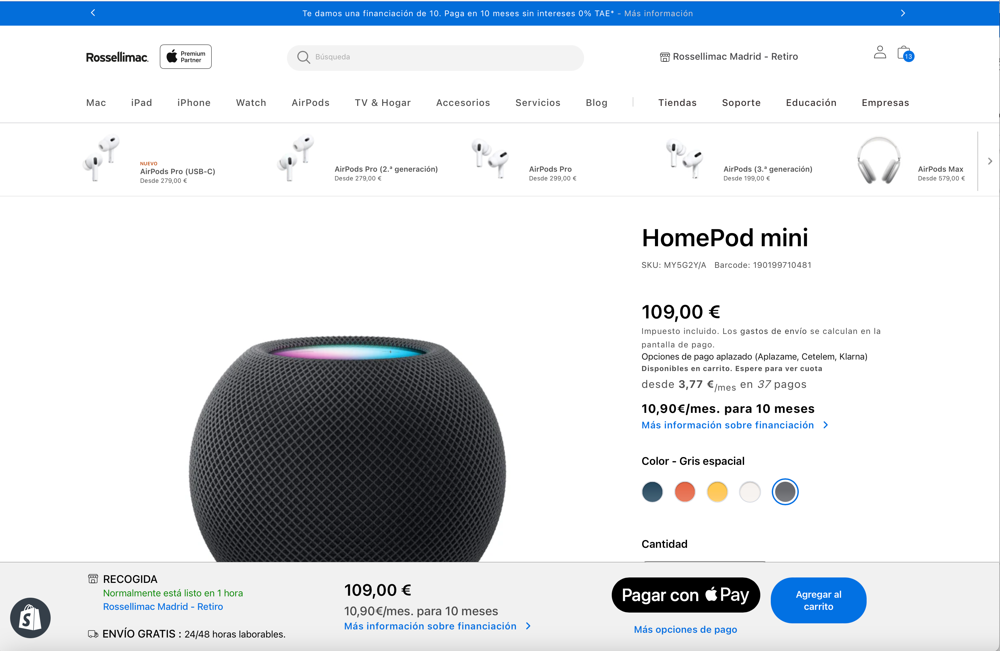

# [2.8] Checkout Button Fallback for Non-Safari Browsers

Series: CX Solution Documents | Universal APP Shopify Theme Release: 2.8 | Applicable pages: Cart Page, PDP

## Background & Problem Statement

Apple Pay is Shopify’s native express checkout button on the cart page and product detail pages. By design, Apple Pay is only available on browsers and devices that support the Apple Pay API — primarily Safari on Apple devices. On Chrome, Firefox, and all other non-Safari browsers, the Apple Pay button is not rendered, leaving a gap in the express checkout flow where no quick-checkout option is presented to the customer.

This means that the majority of desktop users (who use Chrome or Firefox) see no express checkout option at all, requiring them to go through the full standard checkout flow even when a faster path would be desirable. This is a cross-browser parity gap that negatively affects the checkout experience for non-Apple Pay users.

## Solution Overview

A “Checkout” express button has been added as a conditional fallback. It is displayed only when the Apple Pay API is not available (i.e. on Chrome, Firefox, and all non-Safari browsers). On Safari, Apple Pay continues to display as before and the Checkout fallback button is suppressed.

The Checkout button behaves as a direct express path to the Shopify checkout page (`/checkout`), bypassing the standard cart review step — matching the intent of the Apple Pay button as an accelerated checkout entry point.

## Browser Compatibility Matrix

The table below summarises which button is shown and what happens on click, per browser context.

| Context | Safari (Apple Pay supported) | Chrome | Firefox | Other non-Safari |
|---|---|---|---|---|
| Apple Pay button shown? | ✓ Yes | ✕ No | ✕ No | ✕ No |
| Checkout button shown? | ✕ No | ✓ Yes | ✓ Yes | ✓ Yes |
| Express checkout path? | ✓ Yes (Apple Pay) | ✓ Yes (Checkout btn) | ✓ Yes (Checkout btn) | ✓ Yes (Checkout btn) |
| Destination on click | Apple Pay sheet | Shopify checkout (`/checkout`) | Shopify checkout (`/checkout`) | Shopify checkout (`/checkout`) |

## Feature Specification

### BUTTON A — Apple Pay (Safari / Apple Pay-supported browsers only)

| Property | Detail |
|---|---|
| Visibility condition | Shown when `window.ApplePaySession` is available and `canMakePayments()` returns true |
| Label | Apple Pay (rendered as the Apple Pay button mark per Apple guidelines) |
| Behaviour on click | Initiates the Apple Pay payment sheet flow |
| Changed in 2.8? | No — behaviour is unchanged. Apple Pay continues to work exactly as before on supported browsers. |

<figure></figure>

### BUTTON B — Checkout (Chrome, Firefox, and all non-Apple Pay browsers)

| Property | Detail |
|---|---|
| Visibility condition | Shown when Apple Pay API is unavailable (`window.ApplePaySession` undefined or `canMakePayments()` = false) |
| Label | Checkout |
| Button style | Express checkout style — visually consistent with the Apple Pay button in size and placement |
| Behaviour on click | Navigates directly to Shopify checkout (`/checkout`), bypassing the cart review page |
| Position | Same slot as the Apple Pay button — appears in the express checkout button area on the cart page and/or PDP |
| New in 2.8? | Yes — this button is newly introduced in Release 2.8 |
