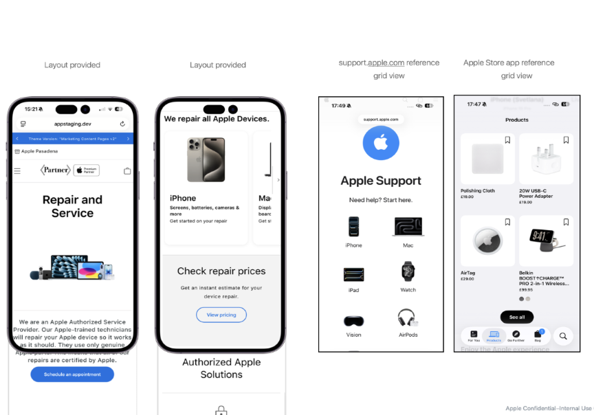

# CX_ AASP LP – Grid view on a mobile screen

## 1. Grid View Feature Overview — AASP Repair and Service Landing Page

Grid View is a new feature on the AASP Repair and Service Landing Page that provides partners with a template to market their repair services on mobile. It introduces a static 2-column tile layout that displays all configured product categories simultaneously on screen load.

This feature enables partners to:

- Present repair and service offerings clearly on mobile, with all categories visible on page load.
- Author tile images and copy to align with their brand and service messaging.
- Link each tile independently to direct customers to specific service or product landing pages.

**Business Need:**

Partners require a mobile landing page layout that allows customers to see all available repair and service categories at a glance, without requiring interaction. Grid View addresses this business need by providing a fully authorable, static tile section that surfaces all categories on page load.

**Figma Link :** For APPs to implement please refer to the box folder : https://apple.box.com/s/49ula877by4hyypqs65qln6gbpt2zn2l

<figure></figure>

## 2. What Is Grid View?

Grid View is a static layout section on the AASP Repair and Service Landing Page for mobile screens. It presents product category tiles in a structured 2-column grid, displaying all configured tiles simultaneously on screen load. The purpose of this feature is to provide partners with a template to market their repair services to customers visiting on mobile.

Key characteristics:

- All tiles are visible on screen load — no horizontal scrolling required.
- Tiles are arranged in a 2-column grid pattern, stacked vertically as needed.
- Maximum of 6 tiles may be present in the grid.
- Each tile supports an image, copy text, and a link to a specific landing page.
- Grid is rendered on mobile screen breakpoint only. Desktop/tablet behaviour is defined separately.

Design reference points include the support.apple.com grid view and the Apple Store app Products grid.

## 3. Where Customers See It?

The Grid View section is displayed to customers who visit the AASP Repair and Service Landing Page on a mobile device.

Visibility conditions:

- Mobile screen breakpoint only — the grid does not appear on desktop or tablet viewports.
- All tiles configured by the partner are visible on initial page load with no interaction required.
- If fewer than 6 tiles are authored, the grid renders with however many tiles have been configured.

The section sits within the existing AASP Landing Page structure, replacing the previous horizontal category scroll at the mobile breakpoint.

## 4. How It Works?

Grid View operates as a static layout component. On page load, all authored tiles are rendered simultaneously in a 2-column grid.

Tile behaviour:

- Each tile displays a partner-authored image and copy text.
- Tapping a tile navigates the user to the configured destination landing page.
- Tiles are independently linkable — each can point to a different landing page.
- Maximum of 3 lines of copy per tile on Mobile.
- Maximum of 4 lines of copy per tile on Tablet.

Grid behaviour:

- Tiles are arranged in a 2-column grid, stacked vertically.
- Maximum of 6 tiles can be configured in the grid.
- If fewer than 6 tiles are authored, the grid renders with the configured count.
- The grid is static — no horizontal scroll, no carousel animation.

## 5. Setup (Step-by-Step)

Partners configure the Grid View via the Shopify content authoring interface. Follow the steps below for each tile:

1. Access the Shopify content authoring interface for your AASP Landing Page.
2. Navigate to the Grid View section on the Landing Page template.
3. For each tile, configure the following:

    | Field | Requirement | Guidance |
    |---|---|---|
    | Image | Required | Select an image from Shopify Files. Use existing PDP images. |
    | Copy | Required | Enter tile text. Keep to 3 lines or fewer on Mobile; 4 lines or fewer on Tablet. |
    | Link | Required | Specify the destination landing page URL for the tile. |
    | Tile count | 1 to 6 tiles | The grid supports a maximum of 6 tiles. Author at least 1 tile to display the section. |

4. Repeat for each tile (up to 6 tiles maximum).
5. Save and publish the Landing Page.
6. Verify the Grid View renders correctly on a mobile device or using browser mobile emulation.

## 6. Why Clients Use This Feature?

Grid View gives partners a fully authorable, globally available template to market their repair services directly on mobile. Partners can present their service categories visually, with custom images, copy, and links, without developer support.

Key benefits for clients:

- Improved category discoverability — all tiles are visible on page load, eliminating the need for horizontal scrolling.
- Reduced reliance on burger menu navigation — customers can find product categories directly from the landing page.
- Flexible content authoring — partners can customise tile images, copy, and links via Shopify without developer support.
- Individual tile linking — each tile can direct customers to a specific, relevant landing page for their repair or service need.
- Consistent, at-a-glance category visibility — all tiles are visible on page load across all markets where the feature is deployed.
