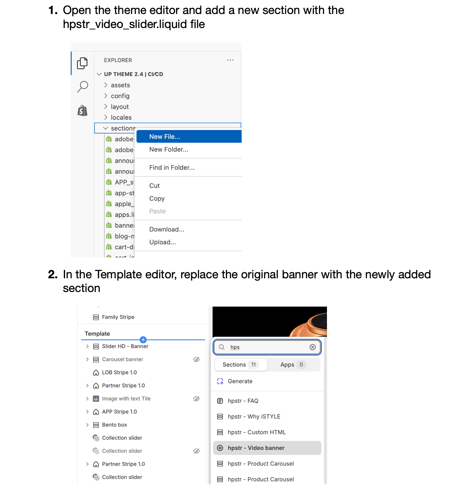

# [2.8] CX_Homepage Video banner

<figure></figure>

The Homepage Video Banner feature enables video content to serve as the default option for the homepage banner carousel. By incorporating Tactical animations into carousels — in place of static images — merchants can deliver a more dynamic and engaging browsing experience, particularly during New Product Introductions (NPI) for eligible partners.

Video banners are inherently more engaging and informative than static images, making them a powerful tool for capturing visitor attention and communicating product value at first glance.

## Why Video Banners?

Video content in hero carousels offers several advantages over static images:

- **Higher engagement:** Motion naturally draws the eye and holds attention longer than static visuals.
- **Better storytelling:** Video allows for product demonstrations, lifestyle context, and brand narrative in a single banner.
- **NPI effectiveness:** During new product launches, video communicates features and excitement more effectively.
- **Competitive differentiation:** Animated banners stand out in increasingly competitive digital storefronts.

## How to Add a Video Banner

Follow the steps below to replace the default static image banner with a video banner using the Theme Editor:

1. Open the theme editor and add a new section with the `hpstr_video_slider.liquid` file
2. In the Template editor, replace the original banner with the newly added section (hpstr - Video banner)
