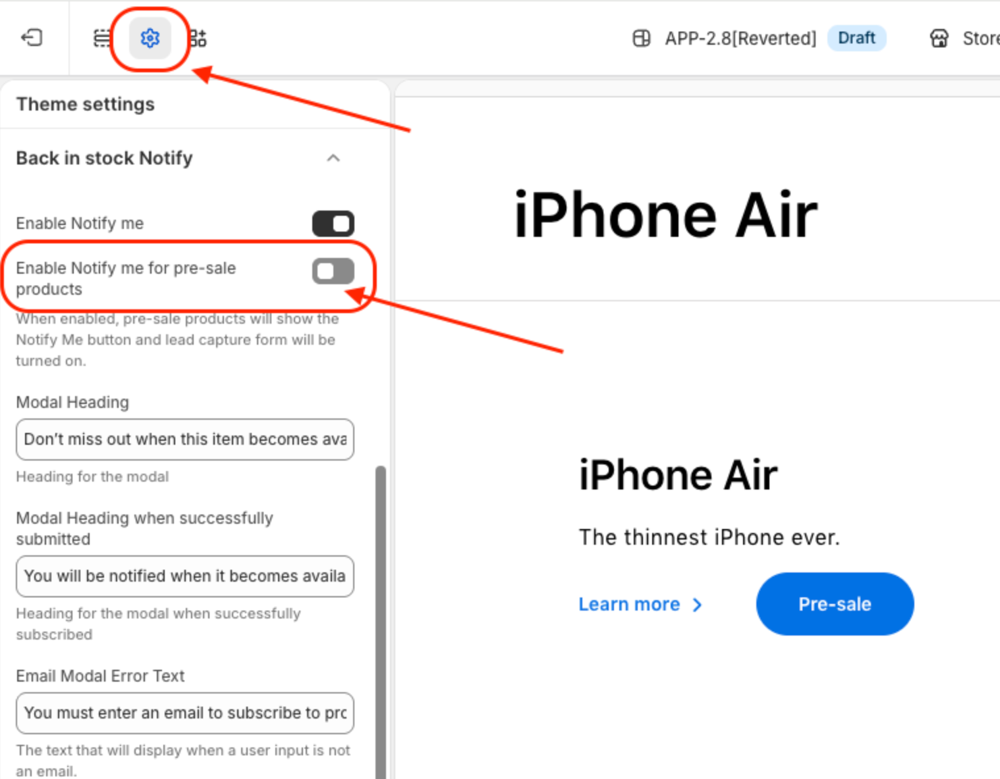

# CX_Pre-sale “Notify Me” for PDP (PDP 1.0 / 2.0)

## Overview

Partners selling brand-name manufacturer products often receive pricing and inventory information in staggered waves. Late-wave partners — those who receive NPI (New Product Introduction) product details after the initial launch — frequently have no price to display for upcoming products and no stock available to sell. Without a standardized way to handle these pre-sale product states, partners were forced to build custom workarounds to capture customer interest before a product became available for purchase.

This feature provides a native, configurable solution: a “Notify Me” button and lead capture modal for pre-sale products, controllable directly from Theme Settings.

## Problem

Late-wave partners could not display prices or sell NPI products at launch. Because the theme had no built-in mechanism to handle pre-sale product states, partners were forced to hide prices manually across the entire site and build their own lead capture flows — often inconsistently and outside of the product detail page (PDP).

Examples of partner workarounds before this feature:

- iCon: Customers browsing the Watch PLP would see a “Notify Me” link that redirected to an external marketing landing page. That page contained another notification form to capture leads — a two-step redirect flow that was fragile and off-brand.
- iShop PE: A “Watch it without stock” button on the PLP sent customers to a PDP with two separate buttons: a greyed-out “Watch it without stock” button and a blue “Notify Me” button that opened a modal with a short lead form. This required custom PDP development for each pre-sale product.

These solutions were time-consuming to build, difficult to maintain, and inconsistent across partners. iStyle UAE had to disable their storefront location selector entirely due to related issues caused by the lack of a native pre-sale flow.

## What Problem Does This Solve?

- Eliminates the need for partners to build custom lead capture flows for pre-sale or NPI products
- Provides a consistent, on-brand customer experience directly on the PDP
- Reduces manual work — no need to individually hide prices or build workarounds per product
- Captures customer leads natively within the theme, without redirecting to external pages
- Works out of the box for both PDP 1.0 and PDP 2.0

## How It Works

When a product is tagged as pre-sale and the toggle is enabled, the theme automatically replaces the standard add-to-cart button with a “Pre-sale” button on the PDP. Clicking it opens a lead capture modal where customers can enter their email address to be notified as soon as the product becomes available. On submission, the theme validates the email, stores the lead, and displays a configurable success message in place of the form — no page reload or redirect required. Because the logic lives natively in the theme, the same behavior applies consistently across every pre-sale product on the storefront, without any per-product development.

The modal text is fully configurable from Theme Settings:

| Setting | Purpose |
|---|---|
| Enable Notify Me for pre-sale products | Master toggle to activate the feature |
| Modal Heading | Text shown at the top of the modal (e.g. “Don’t miss out when this item becomes available”) |
| Modal Heading when successfully submitted | Confirmation message after the customer subscribes (e.g. “You will be notified when it becomes available”) |
| Email Modal Error Text | Validation message shown when an invalid email is entered (e.g. “You must enter an email to subscribe to product updates”) |

## Where to Configure It

Navigate to: Shopify Admin → Online Store → Themes → Customize → Theme Settings → Back in Stock Notify

Toggle on “Enable Notify me for pre-sale products” to activate the feature. All modal copy fields below it become active and can be customized to match the partner’s tone and language.

<figure></figure>

## Where Customers See It

On any PDP where the product is marked as pre-sale, customers will see:

- A “Pre-sale” button in place of the standard add-to-cart button
- Optionally, a “Learn more” link alongside it
- Upon clicking “Pre-sale,” a modal form appears asking for their email address
- After submitting, the modal displays a success confirmation message

## Why Partners Should Use It

| Benefit | Detail |
|---|---|
| No custom development needed | Lead capture is built into the theme — no external landing pages or bespoke PDP builds required |
| Consistent UX | Every pre-sale product follows the same interaction pattern, matching the overall storefront look and feel |
| Lead generation ready | Customer emails are captured at the point of highest intent — the product page itself |
| Fully configurable | Modal copy can be translated and customized per market directly in Theme Settings |
| Works across PDP versions | Supported on both PDP 1.0 and PDP 2.0 |

## Example Use Case

**Scenario:** A consumer electronics reseller is a late-wave partner for the launch of a new flagship smartwatch. Pricing and inventory have not yet been provided by the brand, so the partner has no price to display and no stock to sell — but the product page is already live and driving traffic, and the partner wants to capture that customer interest before launch.

**Before 2.8:** The partner would need to manually hide the price on every affected product, build and host a separate marketing landing page with its own lead form, and link to it from the PLP or PDP — a multi-step redirect flow that pulled customers away from the storefront and required ongoing manual upkeep.

**After 2.8:** The partner enables “Enable Notify me for pre-sale products” in Theme Settings and tags the product as pre-sale. The PDP automatically replaces the add-to-cart button with a “Pre-sale” button. Customers click it, enter their email in the modal, and receive an on-page confirmation — all without ever leaving the product page, and without any custom development from the partner.
