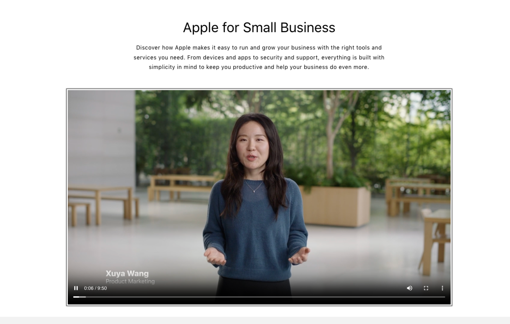

# CX_SMB Video Placement

## What Problem Does This Solve?

Partner storefronts previously lacked a structured way to present Apple’s small business value proposition in a visually engaging format. Text-only sections had limited impact, and partners had no standardized placement to embed promotional or educational video content alongside the “Apple for Small Business” messaging. This feature closes that gap by embedding video directly within the Rich Text section on the SMB-oriented storefront page, improving storytelling and conversion potential for business customers.

## What Is “SMB Video Placement”?

SMB Video Placement is a new content block available within the Rich Text section of the Partner storefront theme. It allows partners to embed a video — such as an Apple for Small Business promotional video — directly beneath the headline and description text on the SMB landing area of the storefront.

The placement follows a defined content order:

1. Heading (e.g., “Apple for Small Business”)
2. Description text (e.g., “Discover how Apple makes it easy to run and grow your business…”)
3. Video block (new in 2.8)

## How It Works

The Video block is added as a child block within the Rich Text section in the Shopify theme editor. Once added, it renders a full-width video player directly below the text content, with a standard play button overlay. The video plays inline on the page without navigating away.

Content order within the Rich Text section (as configured in Shopify):

- Heading — Apple for Small Business title
- Text — Supporting description paragraph
- Video — Embedded video asset (new block)

The section renders sequentially; the video always appears below the text blocks.

## Where Customers See This

Customers visiting the partner’s Business landing page (SMB-facing storefront) see the video positioned directly beneath the “Apple for Small Business” heading and description section. The video is visible on both desktop and mobile breakpoints.

<figure></figure>

<figure></figure>

## Where Admins Configure It

Partners configure this feature inside the Shopify Theme Editor:

1. Navigate to Online Store → Themes → Customize
2. Open the Business Hero page template
3. In the left panel, locate the Rich Text section
4. Under Rich Text, click Add block
5. Select Video
6. Upload or select the video asset
7. Save and publish

The Video block appears as a child item under the Rich Text section in the left-hand section tree (between the Text block and the next section).

## Why Clients Use It

- Reinforces Apple’s small business value proposition with dynamic, engaging media
- Reduces reliance on static imagery alone in the SMB section
- Aligns partner storefronts with Apple brand storytelling standards
- Supports business customer acquisition journeys where video improves time-on-page and intent signals

## Example Scenario

A reseller partner wants to highlight Apple��s productivity ecosystem for SMB customers. They upload a 2-minute Apple for Small Business video through the theme editor. The page now shows:

> Apple for Small Business (Heading) Discover how Apple makes it easy to run and grow your business with the right tools and services… (Text) ▶ [Video plays inline] (Video block)

Business visitors can watch the video without leaving the page, then proceed to “Create business account” or “Business log in.”

## Technical Considerations — Shopify Video Upload Limitations


Important — for partners and CX teams to note when configuring this feature.


Partners may encounter errors when uploading videos through Shopify. The following limitations apply:

| Constraint | Limit |
|---|---|
| Maximum file size | 0.97 GB |
| Maximum video duration | 10 minutes |

Handling upload errors:

- If an upload fails with an error message, check that the video meets the size and duration limits above.
- If an upload fails without any error message, this indicates the platform-level Shopify video upload limit has been reached for the store. To resolve:
  1. Delete unused videos from the Shopify Files section (Settings → Files) to free up capacity, then retry the upload.
  2. If the issue persists after removing unused videos, contact Shopify Support directly.

## Summary

| Item | Detail |
|---|---|
| Feature name | SMB Video Placement |
| Release | 2.8 |
| Section | Rich Text (Business page template) |
| Block type | Video |
| Position | Below Heading and Text blocks |
| Configured in | Shopify Theme Editor |
| Max video size | 0.97 GB |
| Max video duration | 10 minutes |
| Upload error (no message) | Shopify video limit reached — delete unused files or contact Shopify support |
