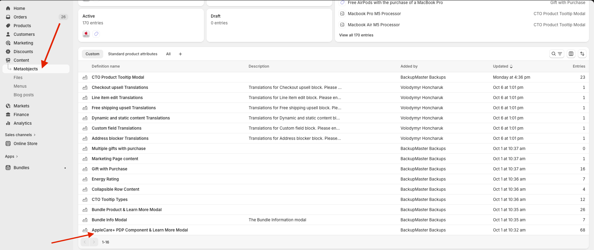
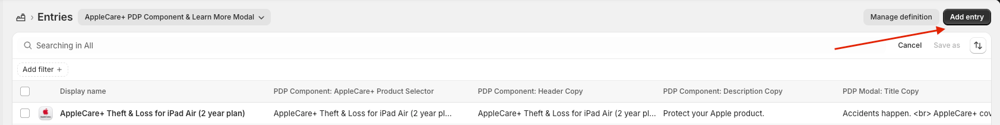
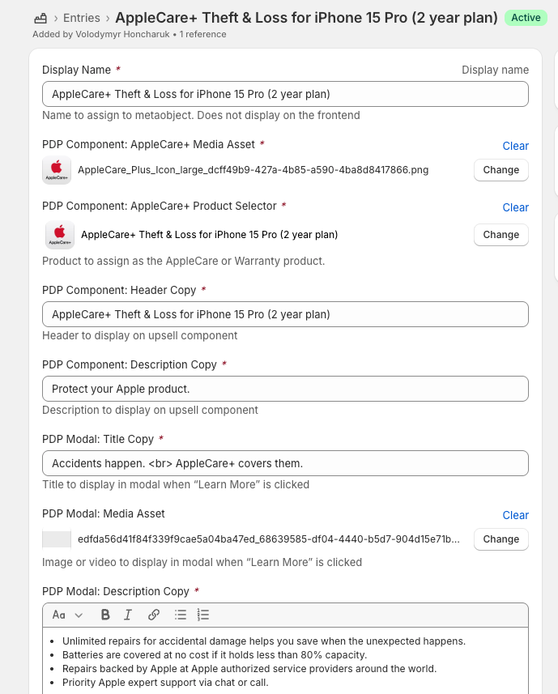
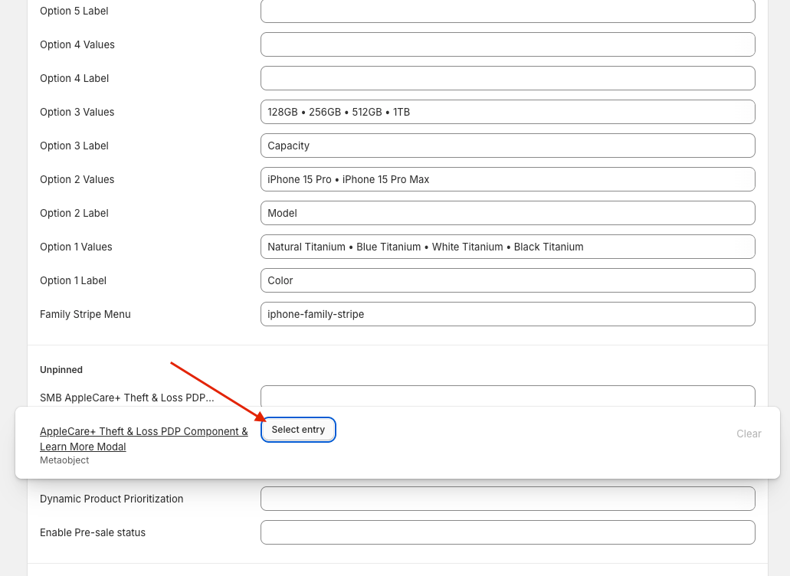
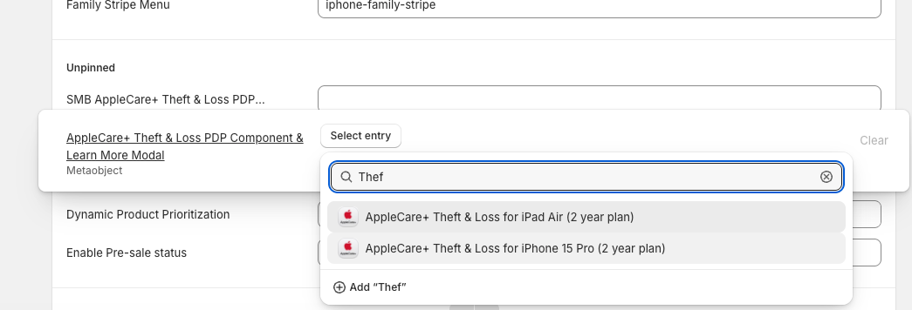
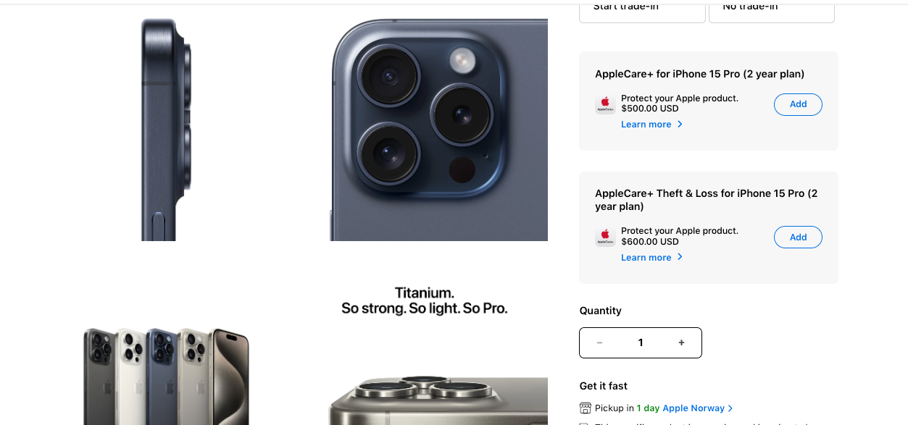
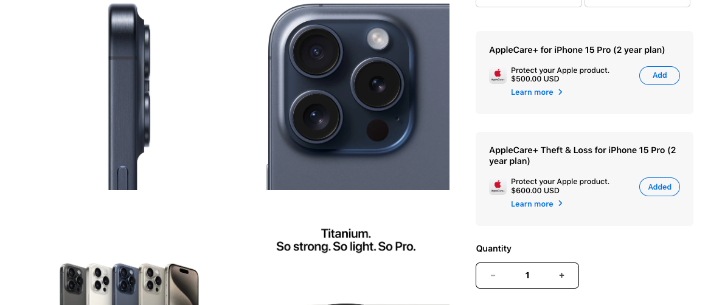
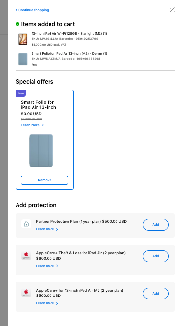
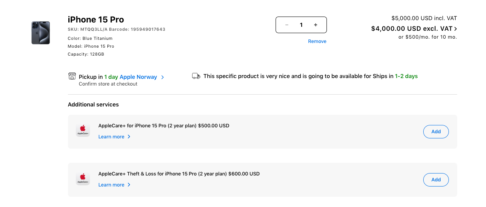
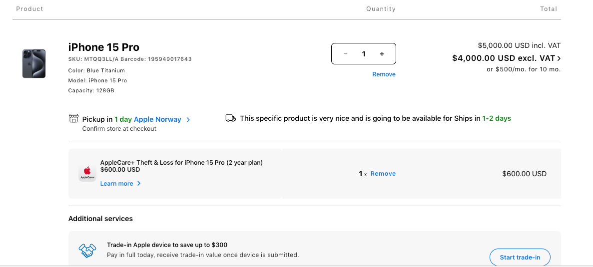

# CX_Theft & Loss - Paid Upfront Option for PDP 1.0 & 2.0 Guideline

This guide provides APP partners with a step-by-step process for enabling and configuring the AC+ Theft & Loss (T&L) addon on Product Detail Pages, supporting both PDP 1.0 and PDP 2.0. This feature allows customers to purchase AppleCare+ with Theft and Loss coverage directly on the PDP alongside the standard AppleCare+ offering, using Shopify Metaobjects to manage all content and product data without any theme code changes.

**Shopify version:** This update applies to Shopify Online Store 2.0 storefronts (Metaobjects and Metafields), and covers configuration for both PDP 1.0 and PDP 2.0 theme templates.

## 1. Purpose of the Guideline

The primary purpose of this document is to enable APP partners to independently configure and activate the AC+ Theft & Loss addon on their storefront. This feature introduces a dedicated second addon slot on PDP 1.0 and PDP 2.0, giving customers the choice between standard AppleCare+ and AC+ with Theft & Loss coverage. By following this guide, you will be able to display the correct T&L marketing copy and pricing per product, ensure customers can only select one AppleCare+ option at a time, and carry the customer's choice seamlessly through to the cart and checkout.

Please note: this guide does not cover creating the AC+ T&L product in Shopify. It assumes the T&L products have already been set up in your product catalog before you begin.

## 2. Configuring the AC+ Theft & Loss Addon

All content, pricing, and product data for the T&L addon is managed through Shopify Metaobjects and Metafields. This section walks you through creating the required data structure and linking it to your products or collections.

### 2.1 Prerequisites

Before you begin, ensure the following are in place:

- The AC+ T&L product and its variants have been created in your Shopify catalog.
- If you have previously configured standard AppleCare+ using a LearnMoreModal metaobject definition, that same definition is reused here. You do not need to create a new definition — only a new entry.

### 2.2 Creating a Metaobject Entry for AC+ Theft & Loss

You need to create an entry that holds the actual T&L content and links to the T&L product.

1. From your Shopify Admin, navigate to Content → Metaobjects.
2. Select the AppleCare+ PDP Component & Learn More Modal definition.
3. Click Add entry.
4. Fill in the fields with content specific to the AC+ Theft & Loss offering:
5. Save the entry. Take note of its name or handle, as you will reference it in the next step.

<figure></figure>

<figure></figure>

<figure></figure>

### 2.3 Assigning the Metaobject to Products or Collections

The metaobject entry you created must be linked to the products where the T&L addon should appear. The theme checks for a T&L configuration in the following order of priority:

1. A metafield set directly on the product (product-level).
2. A metafield set on the product's base collection (collection-level).

The recommended approach is to assign the metafield at the collection level on the relevant base collection (for example, the iPhone 15 collection). This means every product in that collection will automatically display the T&L addon without requiring individual product updates. You should only assign the metafield directly to a product when that product requires different T&L content from the rest of its collection.

#### 2.3.1 Prerequisites

Before adding new metaobject entry you created to products or collections, you must first verify that the corresponding metafields already exist in Shopify's data model. If the product-level metafield AppleCare+ Theft & Loss PDP Component & Learn More Modal or the collection-level metafield AppleCare+ Theft & Loss PDP Component & Learn More Modal is missing, please follow the instructions below to create them:

1. Navigate to Settings > Metafields and metaobjects.
2. Select Products, then click Add definition.
3. Fill in the Name with “AppleCare+ Theft & Loss PDP Component & Learn More Modal”, Type with “Metaobject” one value and the key with “apple.apl_smb_TheftLoss_Component_LearnMoreModal”.
4. Click the Save button.
5. Repeat 1-4 for “SMB AppleCare+ Theft & Loss PDP Component & Learn More Modal”(see appstaging product metafields for the reference).
6. Repeat steps 1-5, but now for a Collection metafield (in step 2, select Collections instead of Products).

The next step is to link the metaobject entry created in step 2.2 to the collection-level metafield created in step 2.3.1:

1. From your Shopify Admin, navigate to Products → Collections.
2. Open the relevant base collection, for example iPhone 15.
3. Scroll down to the Metafields section.
4. Locate to AppleCare+ Theft & Loss PDP Component & Learn More Modal (`apple.apl_TheftLoss_Component_LearnMoreModal`) field and click Select entry to edit it.
5. Search for and select the metaobject entry you created in section 2.2.
6. Save.

<figure></figure>

<figure></figure>

<figure></figure>

<figure></figure>

### 2.4 Configuring for B2B (SMB) Customers

You can provide a separate T&L metaobject entry with different copy, pricing, or terms tailored to that audience. This is optional — if no B2B-specific entry is configured.

To set up a SMB-specific configuration:

1. Create a second metaobject entry following the same steps as section 2.2, this time using SMB-appropriate content.
2. Assign this second entry to your product or collection using the metafield key `apple.apl_smb_TheftLoss_Component_LearnMoreModal` rather than the standard key used in section 2.3.

When a B2B customer views the PDP, the theme will resolve the T&L content in the following fallback order. It will use the first entry it finds.

## 3. How the Feature Works for Customers

This section describes the experience from the customer's perspective once the feature has been configured.

### 3.1 Choosing an Addon on the Product Page

When a customer visits a product page where AC+ T&L has been configured, they will see two addon cards displayed below the main product — one for standard AppleCare+ and one for AppleCare+ with Theft and Loss. Each card shows a thumbnail image, title, short description, the addon price, an Add button, and a Learn More link.

When the customer clicks Add on the T&L card on the PDP (PDP 1.0 or PDP 2.0), the button label changes to Added and the displayed product price updates immediately to reflect the combined price of the hero product plus the T&L addon. If the customer had previously selected standard AppleCare+, that selection is automatically cleared — only one AppleCare+ option can be active at a time. The customer can deselect T&L at any point by clicking the Added button again, which removes the addon and reverts the price to the base product price.

The same mutual exclusivity applies in reverse: if a customer selects standard AppleCare+ while T&L is active, the T&L selection will be automatically removed.

### 3.2 The Cart and Side Sheet

When the customer adds the product to their cart with AC+ T&L selected, both the hero product and the T&L addon are added as separate line items. In the cart drawer (side sheet, if enabled) and on the full cart page, the T&L addon is displayed as a sub-item associated with the hero product.

<figure></figure>

<figure></figure>

<figure></figure>

If the customer did not select T&L on the PDP, they also have the option to add it directly from the cart or a side sheet. Removing the hero product from the cart will also remove the associated T&L addon.

## 4. Active Acceptance for AC+ Theft & Loss

Active acceptance is a required step in the AC+ Theft & Loss (T&L) buy flow. It applies to the AC+ T&L Paid Upfront Option (PUF) across all lines of business, regardless of whether the underlying offer is structured as AC+ T&L or as a subscription. The customer must take a deliberate, explicit action to accept the terms of AC+ T&L before it is attached to their order — it can never be added automatically.

### 4.1 UI/UX and Display Requirements (PDP, Side Sheet, Cart)

- A distinct slot/tile for "AppleCare+ with Theft and Loss" is displayed alongside the existing standard AppleCare+ slot.
- The AC+ T&L tile clearly displays the total price and a summary of the product.
- Selection is strictly opt-in: the default state is unselected, and AC+ T&L is never added automatically.
- A link to the Terms and Conditions (T&Cs) is prominently visible on the tile or within the purchase pathway.

### 4.2 Active Acceptance Flow (the Pop-up)

- Clicking the initial call-to-action on the AC+ T&L tile does not immediately add the item to the cart.
- Instead, clicking the CTA triggers a "Service Overview" pop-up modal.
- The pop-up contains the required Active Acceptance statements, T&C links, and a final "Add" CTA.
- The customer must actively click the "Add" CTA inside the pop-up to attach AC+ T&L to the hero product in the cart.
- This pop-up experience is consistent across all touchpoints: PDP, attach side sheets, and Cart tiles.

### 4.3 Backend and Data Logging

- When a customer successfully adds AC+ T&L via the pop-up, the backend logs a flag — `customerAcceptTerms = Y` — for that specific transaction line item.
- If the customer does not add AC+ T&L, or abandons the flow, no flag is logged (or `customerAcceptTerms = N`).
- The system supports logging this flag independently for multiple hero products with AC+ T&L attachments within a single cart.

### 4.4 Admin Configuration

- The Admin backend provides a toggle to enable or disable the Active Acceptance pop-up requirement specifically for the AC+ T&L tile.

### 4.5 Acceptance Criteria

**Story 1: AC+ T&L Tile Display**

Given a customer is viewing an eligible device on the PDP, Side Sheet, or Cart, when the page loads, then the AC+ T&L tile is displayed as a separate option from standard AC+, the total price and a link to the T&Cs are clearly visible, and the AC+ T&L option is not pre-selected (opt-in only).

**Story 2: Triggering the Service Overview Pop-up**

Given a customer is interacting with the AC+ T&L tile, when the customer clicks the initial CTA on the tile, then a Service Overview pop-up opens and the AC+ T&L plan is not yet added to the cart.

**Story 3: Active Acceptance and Cart Addition**

Given the customer is viewing the Service Overview pop-up for AC+ T&L, when the customer clicks the "Add" CTA inside the pop-up, then the pop-up closes and the AC+ T&L plan is added to the cart as an attachment to the hero device.

**Story 4: Backend Logging for Active Acceptance**

Given a customer has added AC+ T&L to their cart via the pop-up, when the order is placed and the transaction is recorded, then the backend logs the flag `customerAcceptTerms = Y` for that specific AC+ T&L line item, and this logging works correctly even if there are multiple devices with AC+ T&L in the same cart.

**Story 5: Admin Configuration**

Given a store admin is logged into the backend configuration panel, when the admin disables the Active Acceptance setting for AC+ T&L, then clicking the CTA on the frontend tile bypasses the pop-up and adds the item directly to the cart (where applicable for testing or non-Channel regions).

### 4.6 Business Test Cases

<table>
<thead>
<tr><th>Test Case ID</th><th>Description</th><th>Steps to Execute</th><th>Expected Outcome</th></tr>
</thead>
<tbody>
<tr><td>TC-01</td><td>Verify AC+ T&L UI and Opt-in Default</td><td><ol><li>Navigate to PDP of an eligible device.</li><li>Observe the AppleCare section.</li></ol></td><td>AC+ T&L is visible alongside standard AC+. It is not pre-selected. Price and T&C links are clearly displayed.</td></tr>
<tr><td>TC-02</td><td>Verify Pop-up Trigger (No Auto-Add)</td><td><ol><li>Click the CTA on the AC+ T&L tile on the PDP.</li><li>Check the mini-cart/cart status.</li></ol></td><td>The Service Overview pop-up opens. The AC+ T&L item is not added to the cart yet.</td></tr>
<tr><td>TC-03</td><td>Verify Active Acceptance (Add via Pop-up)</td><td><ol><li>Trigger the Service Overview pop-up.</li><li>Click the "Add" CTA inside the pop-up.</li><li>Check cart.</li></ol></td><td>Pop-up closes. AC+ T&L is successfully added to the cart and linked to the hero device.</td></tr>
<tr><td>TC-04</td><td>Verify Pop-up Abandonment</td><td><ol><li>Trigger the Service Overview pop-up.</li><li>Close the pop-up using the 'X' or clicking outside.</li><li>Check cart.</li></ol></td><td>Pop-up closes. AC+ T&L is not added to the cart.</td></tr>
<tr><td>TC-05</td><td>Verify Experience in Cart/Side Sheet</td><td><ol><li>Add a hero device to cart without AC+.</li><li>Navigate to Cart or trigger Attach Side Sheet.</li><li>Click AC+ T&L CTA.</li></ol></td><td>The exact same Service Overview pop-up appears. Behavior matches TC-02 and TC-03.</td></tr>
<tr><td>TC-06</td><td>Verify Backend Logging (Single Item)</td><td><ol><li>Add Device + AC+ T&L via pop-up.</li><li>Complete checkout.</li><li>Query transaction logs in backend.</li></ol></td><td>The transaction log shows customerAcceptTerms = Y for the AC+ T&L attachment.</td></tr>
<tr><td>TC-07</td><td>Verify Backend Logging (Multiple Items)</td><td><ol><li>Add Device A + AC+ T&L via pop-up.</li><li>Add Device B + AC+ T&L via pop-up.</li><li>Complete checkout.</li><li>Query logs.</li></ol></td><td>The transaction log shows customerAcceptTerms = Y for both individual AC+ T&L attachments independently.</td></tr>
<tr><td>TC-08</td><td>Verify Admin Configuration Toggle</td><td><ol><li>In Admin, set AC+ T&L Active Acceptance to OFF.</li><li>Go to PDP and click AC+ T&L CTA.</li></ol></td><td>Pop-up does not appear; item is added directly to cart (or behaves per fallback configuration).</td></tr>
<tr><td>TC-09</td><td>Verify T&C Link Routing</td><td><ol><li>Click the T&C link on the PDP tile.</li><li>Click the T&C link inside the pop-up.</li></ol></td><td>Both links successfully route to the correct, region-specific AppleCare+ T&L Terms and Conditions page.</td></tr>
</tbody>
</table>

## 5. Conclusion

The AC+ Theft & Loss addon is a straightforward configuration exercise once the metaobject definition is in place. By creating a single metaobject entry with the correct product reference and marketing content, and then assigning it to the appropriate products or collections, you can activate the T&L offering on any eligible PDP 1.0 and PDP 2.0. The flexibility of the metaobject structure means you can update T&L copy, swap the linked product, or introduce B2B-specific content at any time, simply by editing the relevant entry in Shopify Admin.
