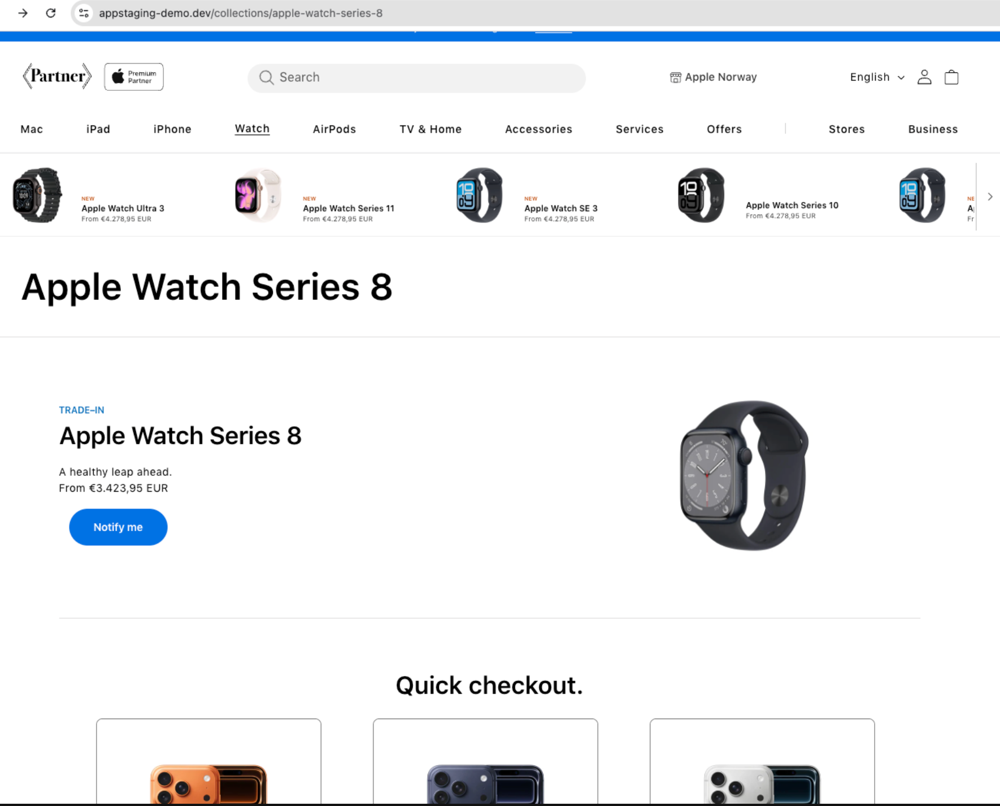
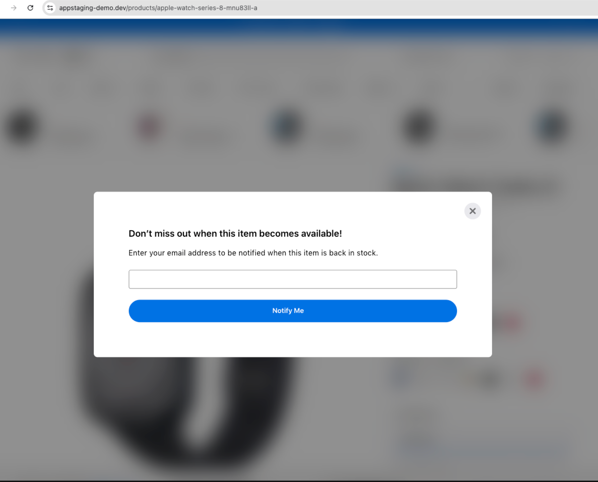

# Notify Me Flow Tracking

This document describes the Notify Me flow tracking introduced in Release 2.8. When a product is out of stock, customers are presented with a “Notify me” option in two distinct locations: a button on the Product Listing Page (PLP) and a link on the Product Detail Page (PDP). Both entry points open the same modal, and all interactions across the full flow are now tracked as marketing engagement events.

<figure></figure>

<figure></figure>

## Scope & Prerequisites

The Notify Me tracking covers three interaction points across two page types. All events share the same event_category ("marketing") and event_action ("Notify Me Click" or "Notify Me Modal Close") but differ in event_location and click_text to distinguish context.

- PLP (Product Listing Page): Notify me button on the product card/listing
- PDP (Product Detail Page): Sticky footer “Notify me when it’s available” link
- Modal close: ‘X’ button within the Notify Me modal on PDP
- Adobe Analytics event61 fires alongside all digitalData.push() calls in this flow

## Tracked Events

### Event 1 - PLP — Notify Me Button

Fired when the user clicks the “Notify me” button on the Apple Watch Series 8 (or equivalent out-of-stock product) listing on the Product Listing Page.

| Parameter | Value | Description |
|---|---|---|
| event | click | Standard interaction event type |
| event_category | marketing | Groups Notify Me events as marketing engagement |
| event_location | Apple Watch Series 8 | Identifies the product listing context on the PLP |
| event_action | Notify Me Click | Captures the click on the Notify Me entry point |
| click_text | Notify me | The visible CTA label the user clicked |
| click_url | /products/apple-watch-series-8-mnu83ll-a | The product URL linked from the PLP entry point |

### Event 2 - PDP — Notify Me Sticky Footer Link

Fired when the user clicks the “Notify me when it’s available” link within the sticky footer on the Product Detail Page. This opens the Notify Me modal.

| Parameter | Value | Description |
|---|---|---|
| event | click | Standard interaction event type |
| event_category | marketing | Groups Notify Me events as marketing engagement |
| event_location | Sticky Footer | Identifies the sticky footer as the interaction origin on PDP |
| event_action | Notify Me Click | Same action value as PLP entry — location differentiates the source |
| click_text | Notify me when it’s available | The exact label of the CTA in the sticky footer |
| click_url | " " (empty) | No destination URL — action opens the modal in-page |

### Event 3 - PDP — Notify Me Modal Close

Fired when the user dismisses the Notify Me modal by clicking the ‘X’ close button. This event is only tracked on the PDP modal; it is not triggered if the modal is opened from the PLP.

| Parameter | Value | Description |
|---|---|---|
| event | click | Standard interaction event type |
| event_category | marketing | Groups Notify Me events as marketing engagement |
| event_location | Notify Me Modal | Identifies the modal itself as the location of the close action |
| event_action | Notify Me Modal Close | Distinct action value to differentiate from the open/click events |
| click_text | Close | The accessible label of the X close button |
| click_url | " " (empty) | No destination URL — action closes the modal in-page |

## Event Comparison Summary

The table below summarises how the three events differ across key fields, making it easy to distinguish them in analytics reports.

| Trigger | event_location | event_action | click_text | Source Page |
|---|---|---|---|---|
| Notify me button | Apple Watch Series 8 | Notify Me Click | Notify me | PLP |
| Sticky footer link | Sticky Footer | Notify Me Click | Notify me when it’s available | PDP |
| Modal X button | Notify Me Modal | Notify Me Modal Close | Close | PDP |

## Implementation Notes

- **Differentiating PLP vs PDP:** Events 1 and 2 share the same event_action ("Notify Me Click") — use event_location to distinguish PLP from PDP interactions in reports.
- **Dynamic event_location on PLP:** event_location for the PLP event is the product name ("Apple Watch Series 8"), not a generic page label. This allows product-level analysis of out-of-stock engagement.
- **Modal close tracking:** The modal close event (Event 3) uses a distinct event_action ("Notify Me Modal Close") to allow funnel drop-off analysis — how many users opened but did not submit the form.
- **Adobe Analytics event61:** Adobe Analytics event61 fires alongside all three digitalData.push() calls. Ensure the event61 mapping is active for the marketing event_category in the AA tag configuration.
- **Empty click_url:** click_url is empty for both PDP events (sticky footer click and modal close) as these are in-page actions. Only the PLP button carries a destination URL.
- **Backward compatibility:** This tracking is additive. The Notify Me form submission event (if tracked separately) is not affected by this change.
