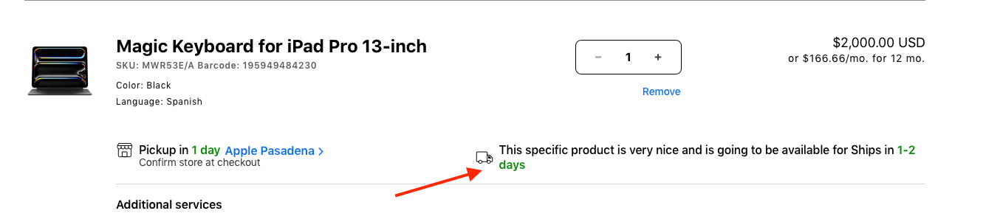
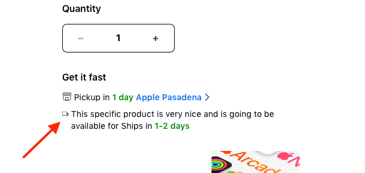
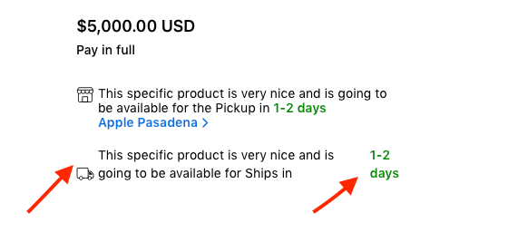

# [2.8] Pickup / Ships Message — Icon & Text Alignment Fixes

## Overview

Three visual alignment bugs were identified in the Pickup and Ships delivery messaging component across the Cart page, PDP 1.0, and PDP 2.0. The issues affected icon-to-text alignment and the positioning of the Pickup time value. All three bugs have been resolved in Release 2.8.


**Component Context**

The affected component is the delivery availability row shown to users beneath the quantity selector (on PDP) and on the cart line item (on the Cart page). It displays two delivery options — Pickup (in-store) and Ships (delivery) — each with an icon, a message, and a highlighted time value (e.g. “1-2 days” in green). Correct alignment of these elements is important for readability and visual consistency.


## Summary of All 3 Fixes

| # | Page / Version | Issue(s) | Fix(es) |
|---|---|---|---|
| 1 | Cart Page | Delivery/ships text not aligned with shipping icon | Icon and text vertically aligned; consistent row layout |
| 2 | PDP 1.0 | Pickup icon oversized relative to adjacent text | Icon size corrected to match text line height |
| 3 | PDP 2.0 | Text not aligned with icon; Pickup time shown in separate detached area | Text-icon alignment fixed; Pickup time displayed inline in correct position |

## Detailed Fix Breakdown

### BUG 1 — Cart Page: Ships Text Not Aligned with Icon

On the Cart page, the shipping delivery message (“This specific product is very nice and is going to be available for Ships in 1-2 days”) was not vertically aligned with its shipping truck icon. The icon was top-aligned while the multi-line text block sat offset, creating a mismatched row.

| BUG 1 — BEFORE (Cart) | FIX — AFTER (Cart) |
|---|---|
| ✕ Ships icon and delivery text vertically misaligned | ✓ Icon and text vertically centred within the row container |
| ✕ Icon appears at top-left while text block floats independently | ✓ Consistent alignment with the Pickup row directly above |
| ✕ Multi-line text wraps but does not align to icon baseline | ✓ Multi-line text wraps correctly while remaining aligned to icon |

<figure></figure>

<figure></figure>

Before:

After:

### BUG 2 — PDP 1.0: Incorrect Pickup Icon Size

On PDP 1.0, the Pickup icon (store/collection icon) was rendered at an incorrect size — larger than intended — causing it to dominate the row and visually overpower the adjacent text. The icon height did not match the line height of the text it accompanied.

| BUG 2 — BEFORE (PDP 1.0) | FIX — AFTER (PDP 1.0) |
|---|---|
| ✕ Pickup icon oversized relative to the text line height | ✓ Pickup icon size corrected to match the text line height |
| ✕ Icon visually dominates the row; inconsistent with Ships icon size | ✓ Visual parity with the Ships icon in the same section |
| ✕ Icon scale does not match the “Get it fast” section visual language | ✓ Consistent icon sizing across Pickup and Ships rows on PDP 1.0 |

<figure></figure>

<figure></figure>

Before:

After:

### BUG 3 — PDP 2.0: Text Misalignment + Pickup Time Detached

PDP 2.0 had two distinct issues within the same component. First, the delivery message text was not aligned with the shipping icon (same root cause as Bug 1). Second, and more significantly, the Pickup time value (“1-2 days” in green) was rendered in a separate, detached area of the row rather than inline within the message text — causing the time value to appear disconnected from its context.

<figure></figure>

<figure></figure>

| BUG 3 — BEFORE (PDP 2.0) | FIX — AFTER (PDP 2.0) |
|---|---|
| ✕ Ships text not aligned with the delivery truck icon | ✓ Text vertically aligned with the icon across both Pickup and Ships rows |
| ✕ Pickup time value (“1-2 days”) displayed in a separate detached block | ✓ Pickup time value rendered inline within the message text |
| ✕ Time value appears in a different column/area, not inline in the message | ✓ “1-2 days” appears in correct green highlight, inline after “Ships in” |
| ✕ Layout breaks the visual reading flow of the delivery message | ✓ Consistent layout with PDP 1.0 and Cart page delivery rows |

Before:

After:
