# [2.8] Pre-sale Fixes (PDP 1.0 / 2.0)

## Background & Problem Statement

Pre-sale products must not be sold before their official availability date: pricing has to stay hidden, add-to-cart actions must be blocked everywhere, and any messaging shown to the customer must make clear the product isn’t available yet. Prior to Release 2.8, the pre-sale status of a product was not consistently recognized across the storefront — some components correctly hid price and blocked purchase, while others (the Family Stripe, PDP configuration switcher, Store availability drawer, bundle pricing, FBT, LOB banners, cart flows, and Dynamic Product Prioritization) still showed pricing, allowed the product to be added to cart, or displayed incorrect availability. This created a risk of customers seeing or purchasing pre-sale products ahead of launch, and of inconsistent messaging across pages.

In Release 2.8, all ten storefront surfaces listed below were updated to consistently check the product’s pre-sale status before rendering price, availability, or add-to-cart actions. Each surface now either suppresses the price and blocks the cart action, or shows a “Notify Me” call-to-action, so that pre-sale products behave the same way everywhere a customer might encounter them. All ten issues below have been resolved and verified for Release 2.8.

## How to Toggle Pre-Sale Mode

Pre-sale status is controlled by a pre-sale flag/metafield set on the product in Shopify admin. To reproduce or verify the behaviour described above:

1. **Turn Pre-Sale ON:** In Shopify admin, open the product and enable the pre-sale flag/metafield. Save the product. The storefront should immediately suppress price display, block add-to-cart on all surfaces, and show “Notify Me” CTAs where applicable.
2. **Turn Pre-Sale OFF:** Disable the same flag/metafield and save. The product reverts to standard behaviour: price is shown, add-to-cart is enabled, and in-store availability reflects real stock data.
3. **Verify across surfaces:** After toggling, check the product on PDP, Family Stripe, Bundle, FBT, LOB page, and Cart to confirm the pre-sale state is respected consistently everywhere.

## Issues Fixed

### Issue 1 — Family Stripe: “From” Pricing Not Displayed

**Component:** Family Stripe

| | |
|---|---|
| Actual | “From” pricing was not displayed on the Mac Accessories card in the Family Stripe. |
| Expected | “From” pricing is displayed on the Mac Accessories card in the Family Stripe. |

**Fix:** The Family Stripe component now correctly reads and renders the “From” pricing field for product cards, including Mac Accessories.

<figure>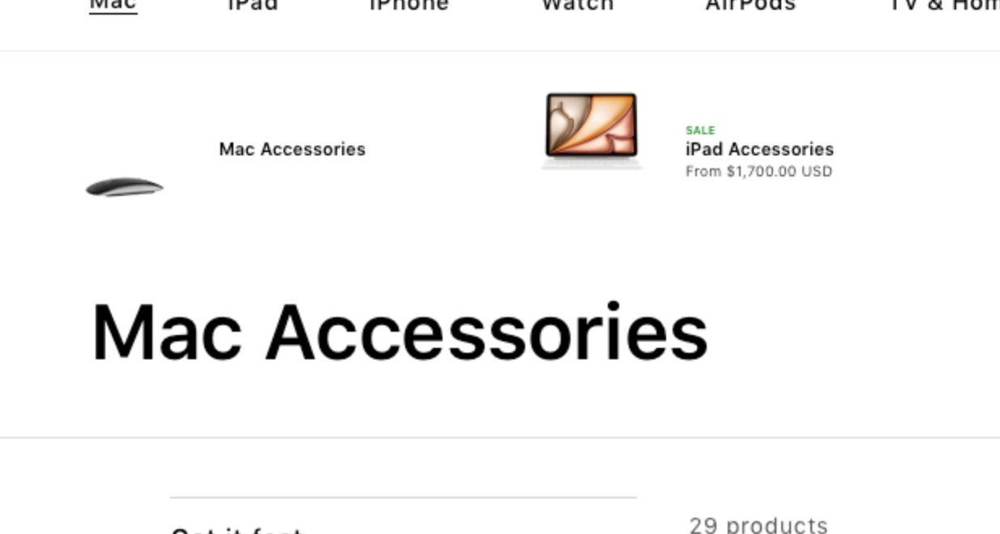</figure>

<figure>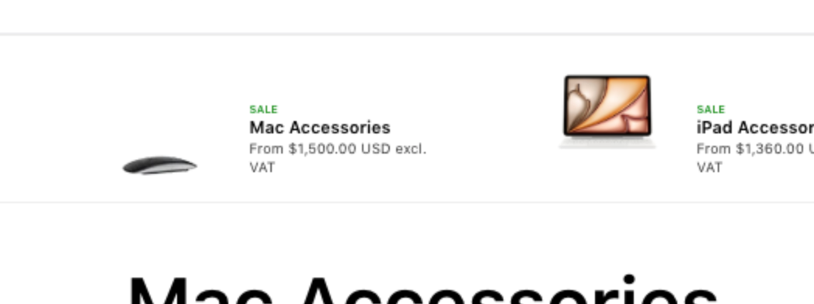</figure>

Before:

After:

### Issue 2 — Pre-Sale PDP: Switching Between Product Configurations Not Working

**Component:** PDP 1.0 / 2.0 — Product Configuration Switcher

| | |
|---|---|
| Actual | Selecting a different product color (e.g. switching away from Sky Blue) did not update the displayed product details. |
| Expected | Selecting a different product color updates all product details (images, title, price, availability) to reflect the chosen configuration. |

**Fix:** The configuration switcher on pre-sale PDPs now correctly triggers a product detail refresh when a different variant is selected.

<figure>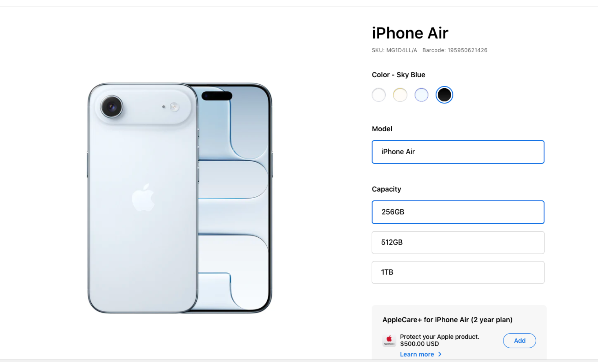</figure>

<figure>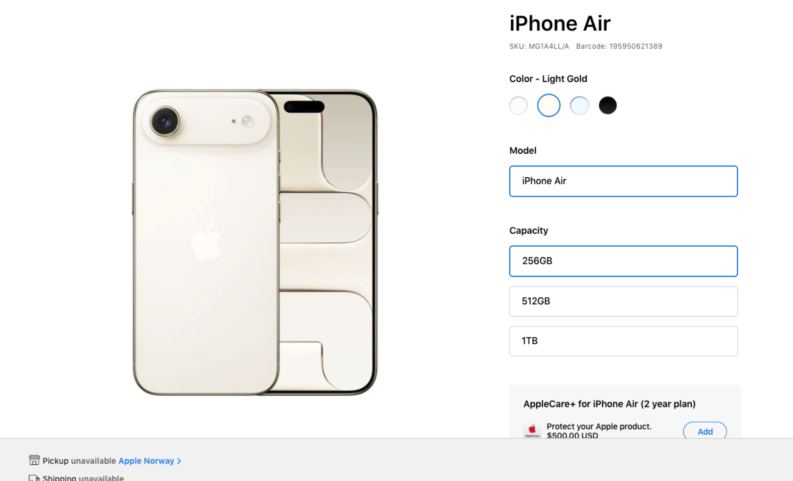</figure>

Before:

After:

### Issue 3 — Pre-Sale Product Shown as Available for Pickup in Store Side Drawer

**Component:** Store Side Drawer (Sticky Footer — “Check In-Store Availability”)

| | |
|---|---|
| Trigger | Click the Store Name link in the Sticky Footer. |
| Actual | The Store Side Drawer showed the pre-sale product as available for in-store pickup. |
| Expected | All stores in the Store Side Drawer display a “Pickup unavailable” message for pre-sale products. |

**Fix:** The Store Side Drawer now checks the pre-sale flag before rendering store availability. Pre-sale products force a “Pickup unavailable” state for every store, regardless of actual stock data.

<figure>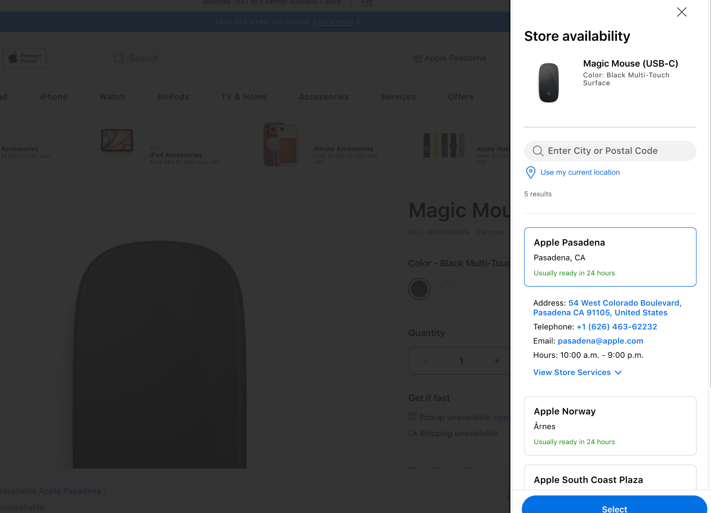</figure>

### Issue 4 — Price Displayed for Pre-Sale Product in Bundle; Product Addable to Cart

**Component:** Bundle Component

| | |
|---|---|
| Trigger | Click a pre-sale product bundle item (e.g. Magic Mouse — Black Multi-Touch Surface). |
| Actual | Price was displayed for the pre-sale bundle item and the product could be added to the cart. |
| Expected | Price is not displayed for pre-sale bundle items. The pre-sale product cannot be added to the cart from the bundle. |

**Fix:** Bundle item rendering now respects the pre-sale flag: price is suppressed and the add-to-cart action is disabled for any bundle item flagged as pre-sale.

<figure>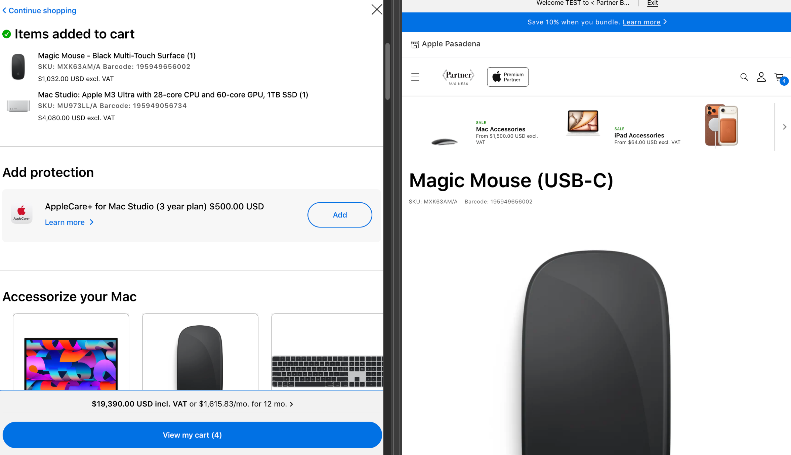</figure>

<figure>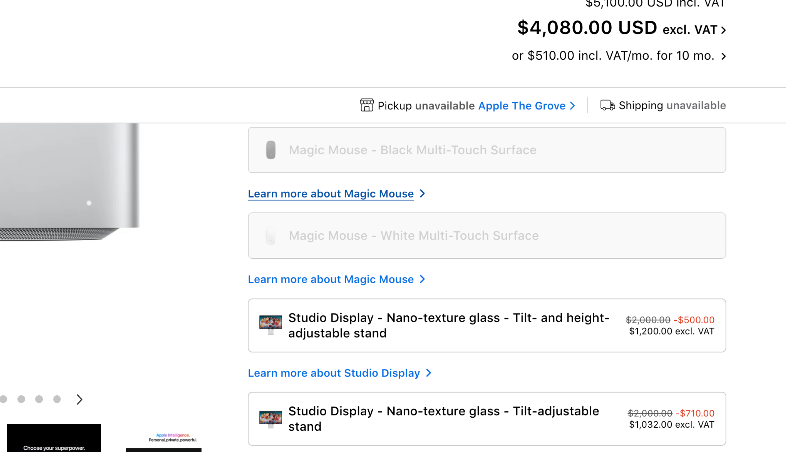</figure>

Before:

After:

### Issue 5 — “Notify Me” Popup: Messaging Updated to Support Pre-Sale Products

**Component:** “Notify Me” Popup

| | |
|---|---|
| Problem | The existing messaging implied the product was previously in stock (“back in stock”), which is inaccurate for pre-sale products that have never been available. |
| Previous text | “Enter your email address to be notified when this item is back in stock.” |
| New text | “Enter your email address to be notified when this item is in stock.” |

**Fix:** The “Notify Me” popup copy has been updated to remove the word “back”. The new message is neutral and accurate for both out-of-stock and pre-sale scenarios.

### Issue 6 — LOB Page: Price Displayed for Pre-Sale Product on Dynamic Banner and Sub-LOB Modules

**Component:** LOB Page — Dynamic Banner, Sub-LOB Modules

| | |
|---|---|
| Actual | Price was displayed for pre-sale products on the Dynamic Banner and Sub-LOB modules. |
| Expected | Price is not displayed. A “Notify Me” CTA is shown instead. |

**Fix:** Both the Dynamic Banner and Sub-LOB module renderers now check for the pre-sale flag. When set, price output is suppressed and a “Notify Me” CTA is rendered in its place.

<figure></figure>

<figure></figure>

Before:

After:

### Issue 7 — Family Stripe: Pre-Sale Product Title Misaligned with Other Product Titles

**Component:** Family Stripe

| | |
|---|---|
| Actual | The title for the pre-sale product was visually misaligned compared to the titles of adjacent products in the Family Stripe. |
| Expected | The pre-sale product title is aligned with the titles of all other products in the Family Stripe. |

**Fix:** CSS alignment for pre-sale product titles in the Family Stripe has been corrected to match the baseline alignment of standard product titles.

<figure>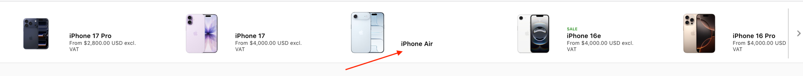</figure>

### Issue 8 — FBT: Price Displayed for Pre-Sale Product

**Component:** Frequently Bought Together (FBT)

| | |
|---|---|
| Actual | A pre-sale product (e.g. iPhone Air 256GB Space Black) displayed a price in the FBT component. |
| Expected | Price is not displayed for pre-sale products in the FBT component. |

**Fix:** The FBT component now suppresses pricing for any item flagged as pre-sale.

<figure>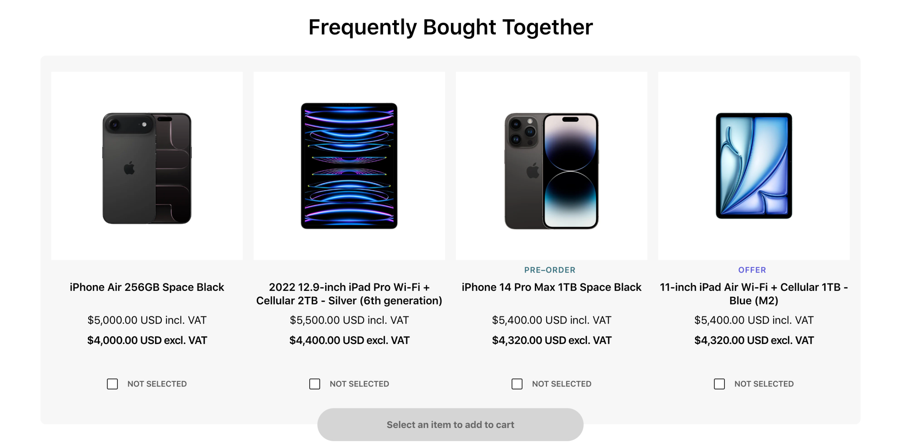</figure>

<figure>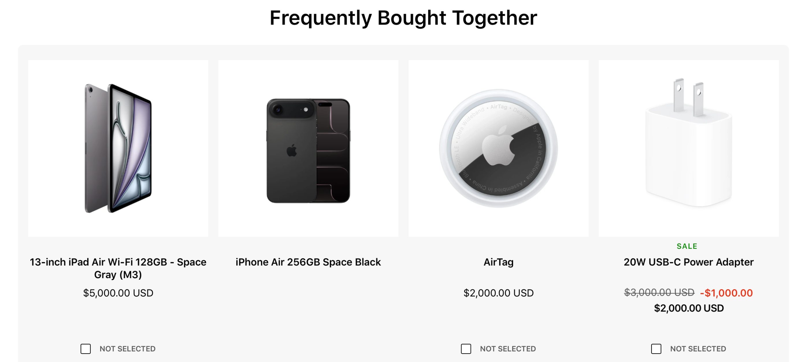</figure>

Before:

After:

### Issue 9 — Pre-Sale Product Can Be Added to Cart as a Free / Discounted Product

**Component:** PDP (Mini Cart flow) / PDP (Side Drawer flow) / Cart Page

This issue covers two separate add-to-cart surfaces.

**9a — PDP with Mini Cart**

| | |
|---|---|
| Actual | Pre-sale product was added to the cart. Price for the pre-sale product was displayed on the Cart page. |
| Expected | Pre-sale product cannot be added to the cart from the PDP. Price is not displayed for the pre-sale product on the Cart page. |

**9b — PDP with Side Drawer**

| | |
|---|---|
| Actual | Pre-sale product could be added to the cart via the Side Drawer. Price was not displayed in the Side Drawer or on the Cart page, but the item was still added. |
| Expected | Pre-sale product cannot be added to the cart from either the Side Drawer or the PDP. Price is not displayed for the pre-sale product on the Cart page. |

**Fix:** Add-to-cart logic on both the Mini Cart and Side Drawer paths now validates the pre-sale flag before allowing the item to be added. Pre-sale products are blocked from being added to the cart from any surface. Additionally, price suppression is enforced on the Cart page for any pre-sale product that may have entered the cart through a prior session.

<figure>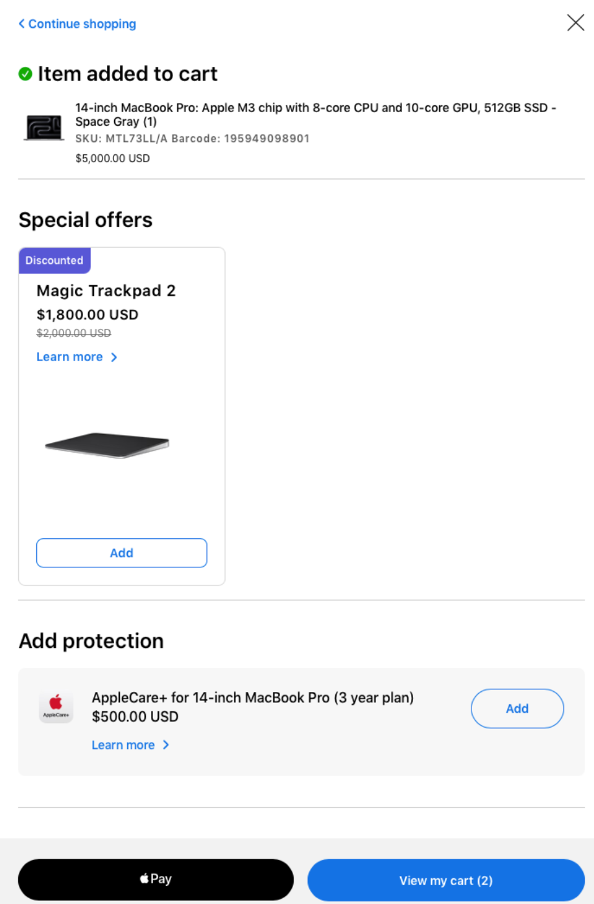</figure>

<figure>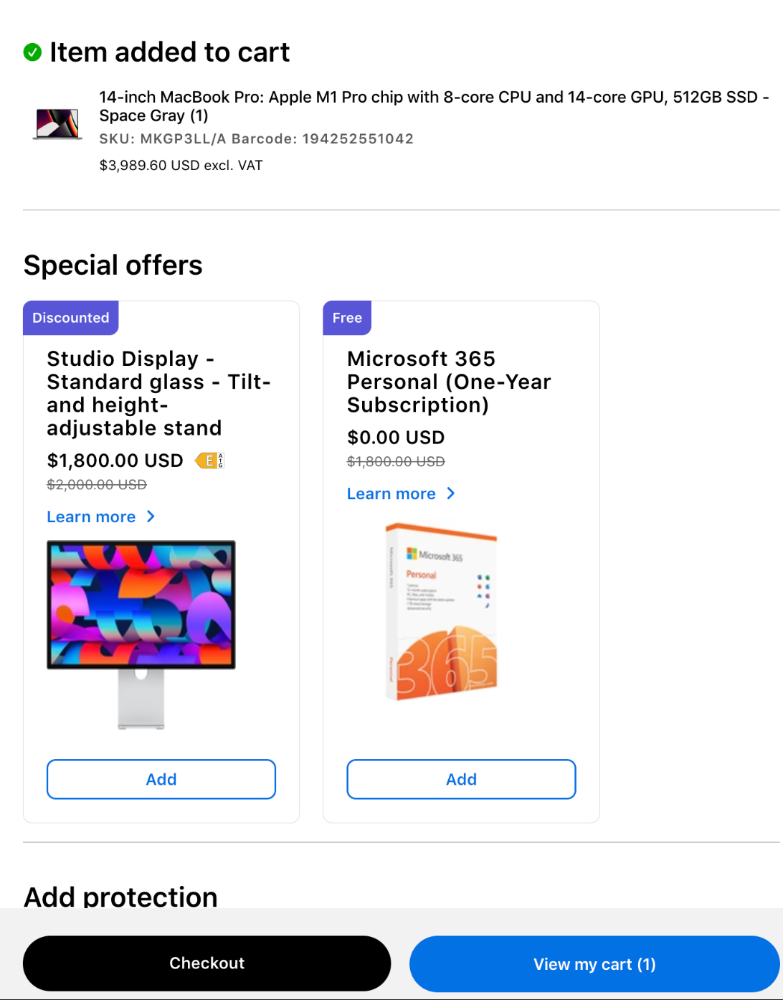</figure>

Before:

After:

### Issue 10 — Pre-Sale: Price Displayed When Product Is Set as Dynamic Product Prioritization

**Component:** Dynamic Product Prioritization

| | |
|---|---|
| Actual | Price was displayed for a pre-sale product when it was configured as a Dynamic Product Prioritization item. |
| Expected | Price is not displayed for pre-sale products regardless of how they are configured or surfaced. |

**Fix:** The Dynamic Product Prioritization rendering layer now checks the pre-sale flag and suppresses price output accordingly. Pre-sale status takes precedence over all product prioritization configurations.

## General Pre-Sale Rules (All Surfaces)

| Rule | Detail |
|---|---|
| Price display | Price is never displayed for a pre-sale product on any surface (PDP, FBT, Bundle, LOB, Family Stripe, Cart, Dynamic Banner, DPP). |
| Add to cart | A pre-sale product cannot be added to the cart from any surface or flow (PDP, Mini Cart, Side Drawer, Bundle). |
| In-store availability | All stores show “Pickup unavailable” for pre-sale products. No availability data is rendered. |
| “Notify Me” CTA | Surfaces that would otherwise show a price or an add-to-cart action for a pre-sale product display a “Notify Me” CTA instead. |
| “Notify Me” messaging | “Enter your email address to be notified when this item is in stock.” (No “back” — product may never have been in stock.) |
| Product configuration switcher | Switching variants on a pre-sale PDP updates all product details correctly. |
| Visual alignment | Pre-sale product titles are aligned consistently with non-pre-sale product titles in shared components (e.g. Family Stripe). |

## Implementation Steps

The ten pre-sale issues were resolved and verified using the following approach:

1. **Audit pre-sale flag propagation:** Each of the ten affected storefront surfaces (Family Stripe, PDP configuration switcher, Store Side Drawer, Bundle, “Notify Me” popup, LOB Dynamic Banner/Sub-LOB modules, FBT, Mini Cart, Side Drawer cart flow, Dynamic Product Prioritization) was audited to confirm whether it read and respected the product’s pre-sale flag.
2. **Apply per-surface fixes:** Each surface’s rendering logic was updated to check the pre-sale flag before displaying price or enabling add-to-cart, per the fix described for each issue above — for example, suppressing price output, disabling add-to-cart buttons, or forcing a “Pickup unavailable” state.
3. **Update supporting copy:** The “Notify Me” popup messaging was corrected to remove language implying prior availability (“back in stock” → “in stock”), since pre-sale products have never been in stock.
4. **Correct visual inconsistencies:** CSS alignment issues introduced by pre-sale-specific markup (e.g. Family Stripe title misalignment) were fixed to match standard product styling.
5. **Regression test with the toggle:** Each fix was verified by toggling the pre-sale flag on/off (see “How to Toggle Pre-Sale Mode” above) and confirming correct behaviour on both PDP 1.0 and PDP 2.0, across all ten affected surfaces.
6. **Release:** All ten fixes were bundled and shipped together in Release 2.8.
