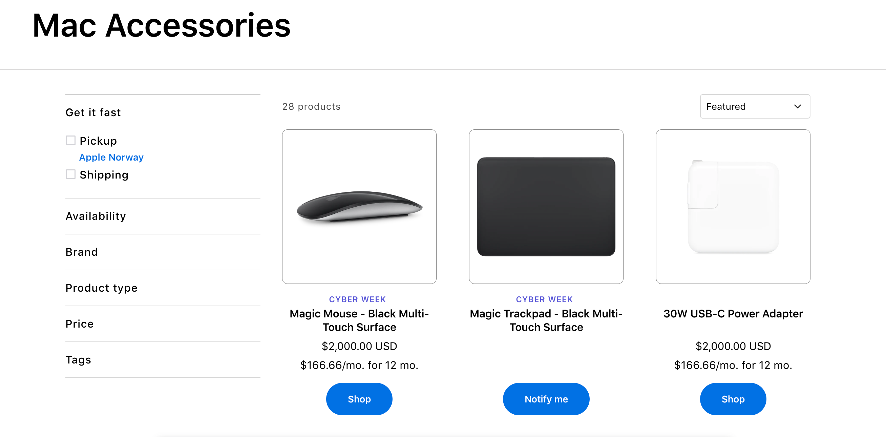
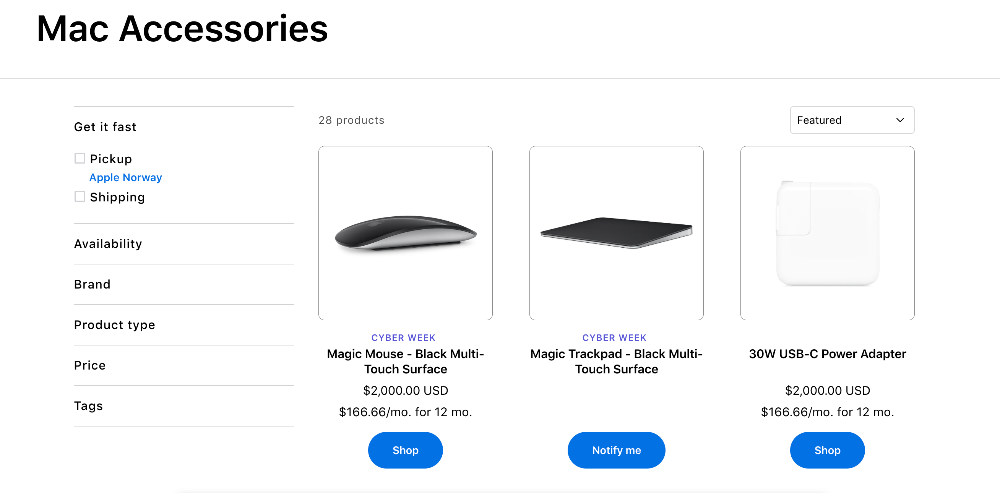

# Show the second image on hover

This document describes the second image on hover feature introduced in Release 2.8. When a user hovers over a product card on a collection page (PLP), the product image transitions from the primary image to the secondary image associated with that product. When the cursor leaves the card, the image reverts to the primary image. This is a purely front-end visual enhancement with no tracking payload — it requires no changes to the analytics layer.

<figure></figure>

<figure></figure>

## Example

On the Mac Accessories collection page, the Magic Trackpad — Black Multi-Touch Surface product card shows an angled perspective image by default. On hover, this is replaced with a flat, top-down image of the same product.

## Feature Behaviour

- The feature applies to product cards on all PLP / collection pages. Each card with at least two product images assigned in Shopify will display the image swap behaviour on hover.

| DEFAULT STATE (no hover) | HOVER STATE |
|---|---|
| First product image displayed | Second product image displayed (crossfade transition) |
| Typically: angled/lifestyle shot (e.g. trackpad shown at perspective angle) | Typically: flat/front-facing shot (e.g. trackpad shown from directly above) |

## Requirements & Conditions

The following conditions must be met for the hover image swap to function correctly on a product card.

| Condition | Detail |
|---|---|
| Minimum images | The product must have at least 2 images uploaded in Shopify Admin. If only 1 image exists, no swap occurs and the card behaves as before. |
| Image order | The first image (position 1) in the Shopify product media gallery is shown by default. The second image (position 2) is shown on hover. |
| Page context | Feature applies on PLP / collection pages only. PDP (product detail page) image behaviour is not affected. |
| Device | Hover state is triggered by mouse cursor on desktop. On touch/mobile devices (no hover capability), the default first image is always shown — no interaction required. |
| Transition | The swap uses a CSS opacity crossfade. Both images are pre-loaded in the DOM; JavaScript toggles the visible image on `mouseenter` / `mouseleave` events. |
| Card types | Applies to all product card variants: standard in-stock cards (showing “Shop” button) and out-of-stock cards (showing “Notify me” button). The button state is independent of the image swap. |

## Content Requirements

To ensure the feature works as intended for all products, the following content guidelines apply for the Shopify product catalogue.

- All products intended to show the hover swap must have a minimum of 2 images in the Shopify Admin product media gallery.
- Image 1 (default): Should be the primary marketing or lifestyle image — typically an angled or styled shot.
- Image 2 (hover): Should be a complementary alternate view — typically a front-facing, flat, or detail shot of the same product.
- Both images should share the same dimensions and aspect ratio to avoid layout shift on swap.
- Products with only one image will display that image at all times — the hover behaviour is gracefully absent (no error state).
