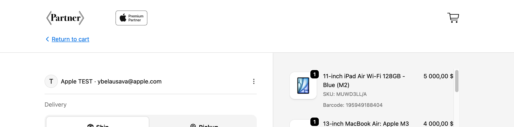
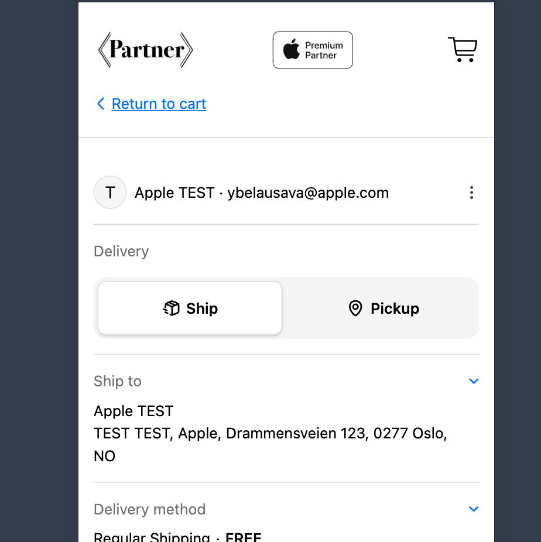

# [2.8] View Cart CTA on Checkout

## Background & Problem Statement

iSTYLE observed that customers frequently need to return to the cart during the checkout flow but struggle to find a clear way to do so. The existing route back to cart — the cart icon in the checkout header — is small, unlabelled, and located in a non-sticky header that scrolls out of view on longer checkout pages. This friction point leads to customer confusion and potentially abandoned checkouts.

## Business Motivation

Reducing cart-return friction at checkout supports conversion by ensuring customers who want to adjust their cart (add, remove, or change items) can do so easily rather than abandoning the checkout entirely. A clearly labelled return path also improves the perceived trustworthiness of the checkout experience.

## Solution Overview

Two complementary cart-return mechanisms have been added to the Shopify checkout page. Both are present on all checkout steps (delivery, shipping method, payment) and are visible on both desktop and mobile viewports.

- A breadcrumb-style link labelled “‹ Return to cart” is displayed below the header in the checkout flow, providing a clearly visible, text-labelled navigation link back to the cart.
- This approach mirrors a familiar e-commerce pattern (used widely across major retailers) and provides a persistent, unambiguous way for customers to backtrack at any point during checkout.
- The implementation is applied both to the Shopify Checkout extension and replicated in the Shopify Theme, ensuring consistent behaviour across headless and theme-rendered checkout contexts.

## Feature Specification

### COMPONENT 1 — Return to cart Breadcrumb Link

| Property | Detail |
|---|---|
| Label | ‹ Return to cart |
| Element type | Hyperlink / anchor element |
| Destination | The customer’s active cart page (`/cart`) |
| Position — Desktop | Below the checkout header, left-aligned above the delivery section. Visible without scrolling on page load. |
| Position — Mobile | Below the checkout header, full-width, above the account/email display row. Visible without scrolling on page load. |
| Appearance | Blue hyperlink text with left-chevron prefix (‹). Matches the existing Shopify checkout link style. |
| Persistence | Present on all checkout steps: delivery, shipping method, and payment. Not removed on step progression. |
| Behaviour | Clicking navigates the user back to `/cart`. Cart contents are preserved (standard Shopify cart session behaviour). |

<figure></figure>

<figure></figure>

### COMPONENT 2 — Cart Icon (Existing, Enhanced Context)

The existing cart icon in the checkout header remains in place. The addition of the “‹ Return to cart” breadcrumb link complements it by providing a labelled, text-based alternative that is more discoverable, especially on mobile and when the header has scrolled out of view.

| Property | Detail |
|---|---|
| Cart icon position | Top-right of the checkout header (existing, unchanged) |
| Cart icon label | None (icon only — unchanged) |
| Header sticky | No — header scrolls out of view on longer pages (unchanged). The ‹ Return to cart link addresses this gap. |
| Relationship to breadcrumb | Both elements link to `/cart`. The breadcrumb link is the primary user-facing CTA; the cart icon is a secondary, power-user shortcut. |

## Viewport Behaviour

The “‹ Return to cart” link is present and functional on both desktop and mobile. Layout positioning differs slightly between viewports.

| DESKTOP — Behaviour & Position | MOBILE — Behaviour & Position |
|---|---|
| Link appears immediately below the checkout header, left-aligned. | Link appears immediately below the checkout header, displayed above account/email row. |
| Positioned above the customer account/email display row and delivery section. | Full content area width — tappable across the left portion of the screen. |
| Text size and spacing match the desktop checkout UI conventions. | Larger touch target ensures usability on small screens. |
| Cart icon remains in the top-right header (non-sticky, unchanged). | Cart icon remains in top-right header (non-sticky, unchanged). |
| Both elements link to `/cart` with cart session preserved. | Both elements link to `/cart` with cart session preserved. |
